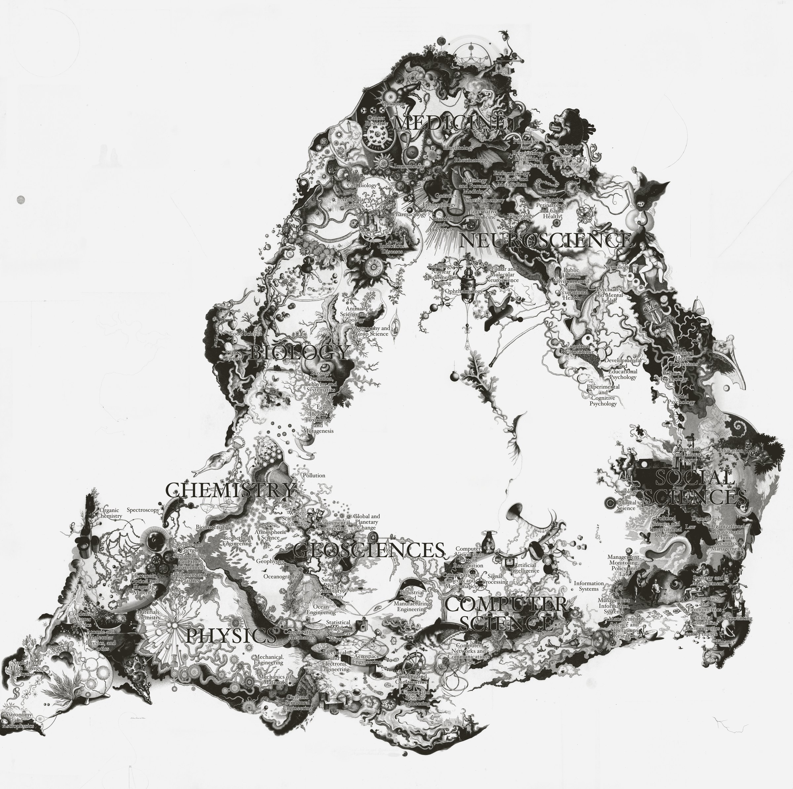
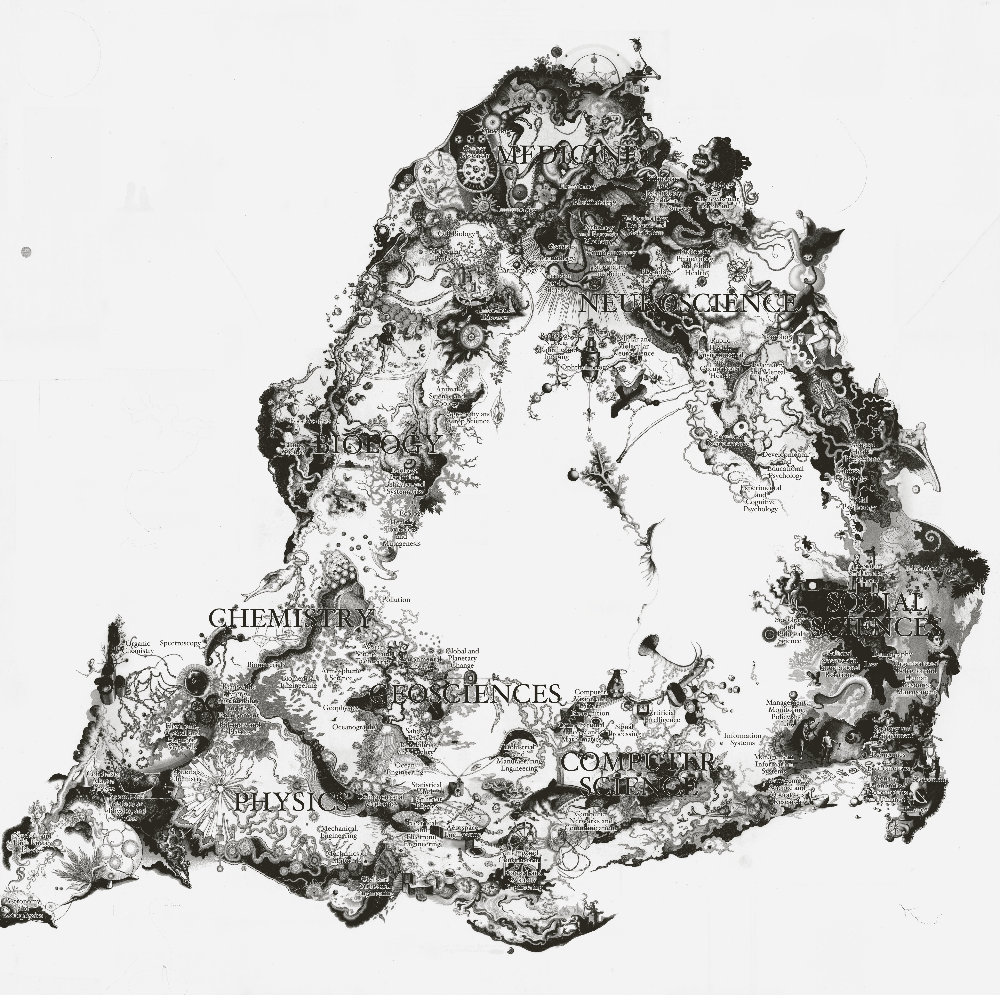
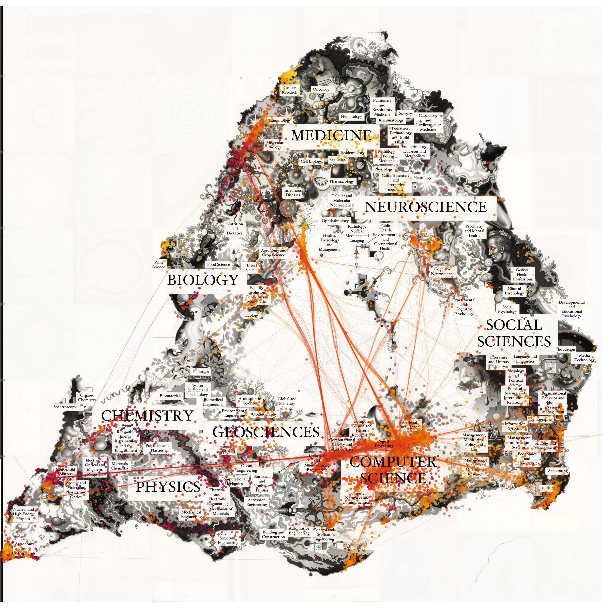
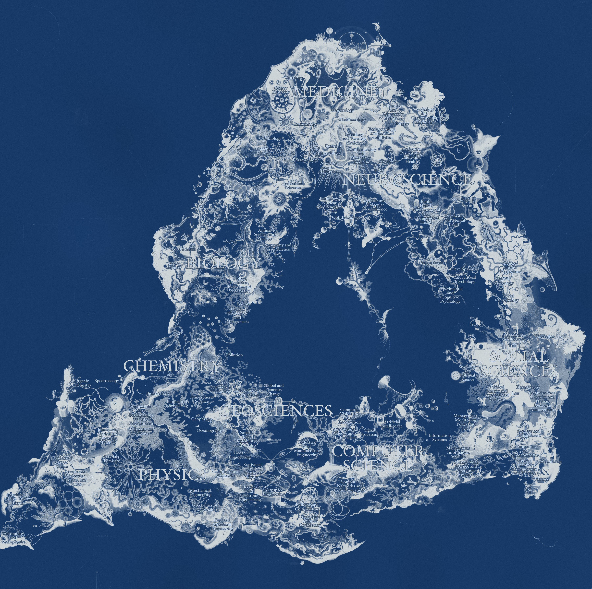
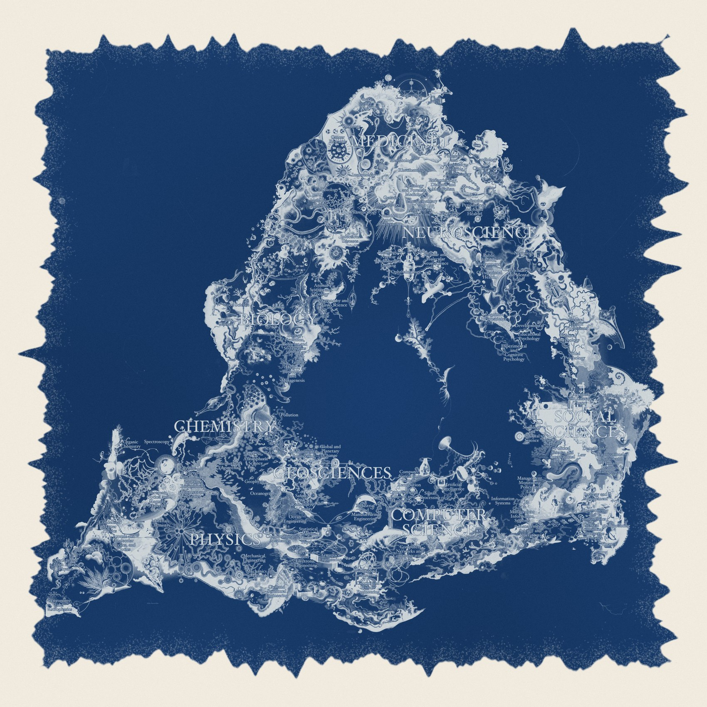
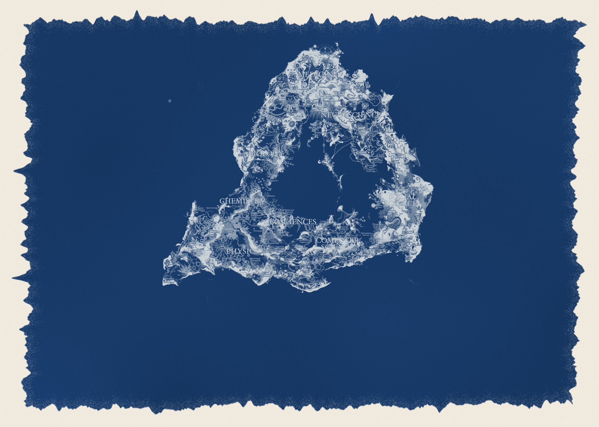
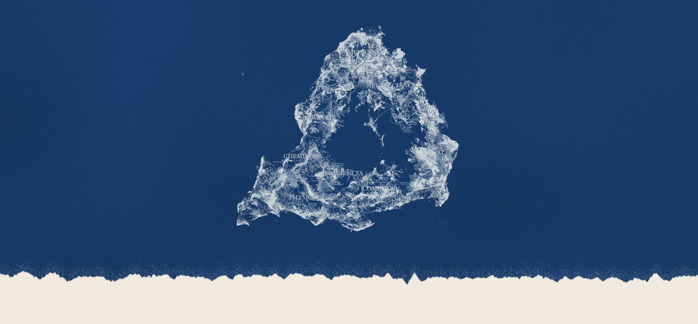
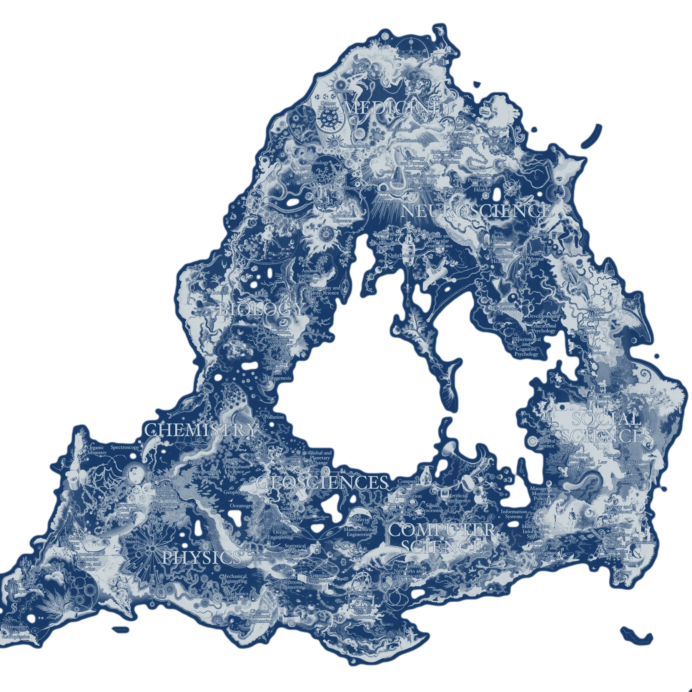
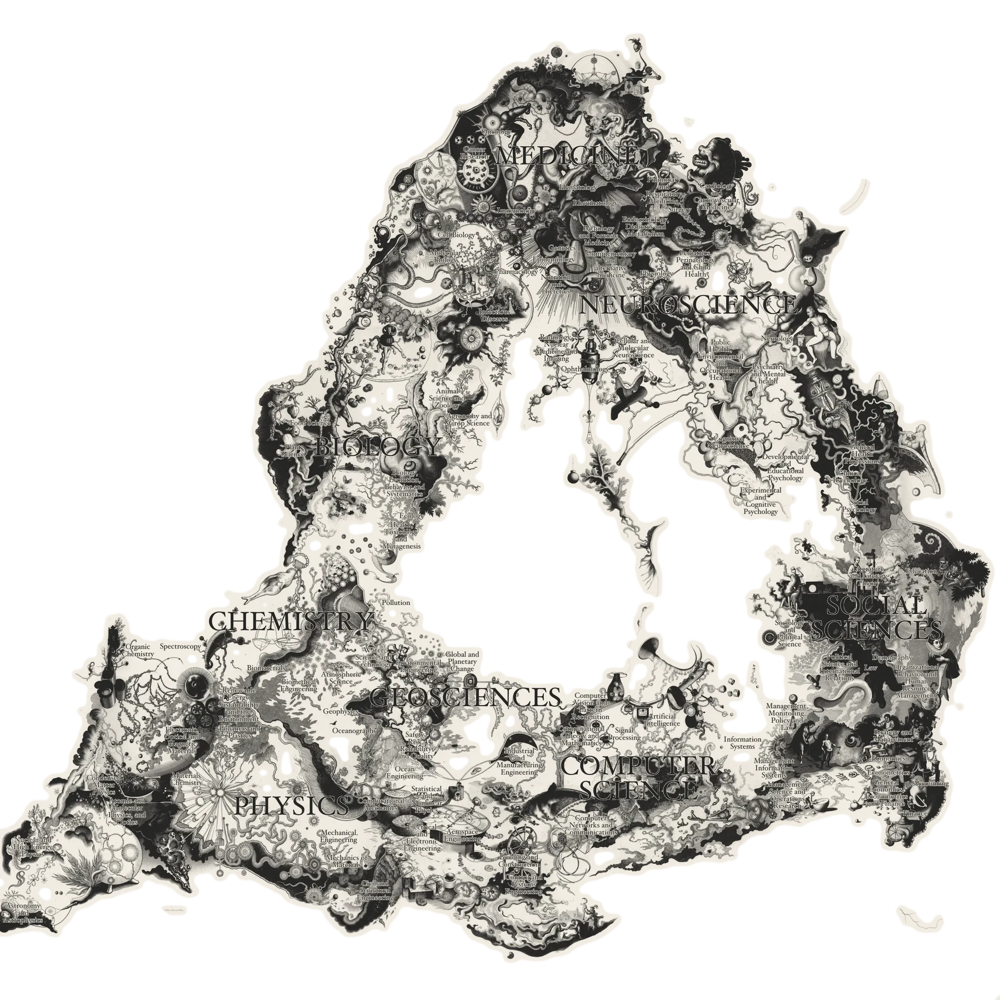

---
format:
  revealjs:
    title-slide: false
    pagetitle: "Design studies: engraving slides"
    theme: [default, design.scss]
    width: 1400
    height: 1000
    margin: 0
    center: false
    auto-stretch: false
    controls: true
    slide-number: false
    transition: none
    background-transition: none
    navigation-mode: linear
    hash-type: title
---

<!--
  Design studies for the HAI101 talk (LSE, 6 Nov 2026).
  Every slide is laid out on a fixed 1400 x 1000 stage (see design.scss).
  Engraving crops are plain  elements: width = zoom, left/top = crop.
  The small "No. xx" tag in the bottom-right corner is only for this study deck.
-->

# {#d00 .idea}

```{=html}
<div class="stage">
  <div class="lab" style="left:110px;top:92px;color:#8e1b14">Design studies · HAI101 talk · LSE, 6 November 2026</div>
  <div class="ttl" style="left:104px;top:138px;font-size:86px;">Twenty ways to<br><i>set the engraving</i></div>
  <div class="rule" style="left:110px;top:352px;width:180px"></div>
  <div class="abs" style="left:110px;top:384px;width:540px;font-size:25px;line-height:1.42">
    Alternatives to the black title boxes. These are classical layouts that let the engraved map carry the slide: type sits in the
    empty paper, the hollow of the triangle, or on light labels, and the engraving is cropped into plates, medallions and headpieces.
  </div>
  <div class="abs" style="left:110px;top:640px;width:540px">
    <div style="font-size:58px;line-height:1">Newsreader <i>Italic</i></div>
    <div class="jost" style="font-size:15px;letter-spacing:.2em;text-transform:uppercase;color:#6e6e6e;margin-top:10px">Titles, body text, captions</div>
    <div class="jost" style="font-size:46px;line-height:1;margin-top:34px;font-weight:400">Jost <span style="letter-spacing:.24em;font-size:30px">LABELS</span></div>
    <div class="jost" style="font-size:15px;letter-spacing:.2em;text-transform:uppercase;color:#6e6e6e;margin-top:10px">Small print, kickers, numbers</div>
  </div>
  <div class="abs" style="left:760px;top:96px;width:540px;font-size:21px;line-height:1.62">
    <div class="jost" style="font-size:14px;letter-spacing:.22em;text-transform:uppercase;color:#6e6e6e">Title slides</div>
    <div><span class="jost accent">01</span>&ensp;Title page with plate</div>
    <div><span class="jost accent">02</span>&ensp;Cartouche in the void</div>
    <div><span class="jost accent">03</span>&ensp;Type in the empty paper (ivory)</div>
    <div><span class="jost accent">04</span>&ensp;Atlas page, split</div>
    <div><span class="jost accent">05</span>&ensp;Vignette</div>
    <div><span class="jost accent">06</span>&ensp;Watermark title page</div>
    <div><span class="jost accent">07</span>&ensp;Double-page spread</div>
    <div class="jost" style="font-size:14px;letter-spacing:.22em;text-transform:uppercase;color:#6e6e6e;margin-top:12px">Structure &amp; section dividers</div>
    <div><span class="jost accent">08</span>&ensp;Contents with leaders</div>
    <div><span class="jost accent">09</span>&ensp;Headpiece</div>
    <div><span class="jost accent">10</span>&ensp;Banderole across a detail</div>
    <div><span class="jost accent">11</span>&ensp;Medallion</div>
    <div><span class="jost accent">12</span>&ensp;Annotated map</div>
    <div><span class="jost accent">13</span>&ensp;Planche with legend</div>
    <div><span class="jost accent">14</span>&ensp;Plate mark &amp; mount</div>
    <div><span class="jost accent">15</span>&ensp;Letters cut from the engraving</div>
    <div class="jost" style="font-size:14px;letter-spacing:.22em;text-transform:uppercase;color:#6e6e6e;margin-top:12px">Content &amp; closing</div>
    <div><span class="jost accent">16</span>&ensp;Book page</div>
    <div><span class="jost accent">17</span>&ensp;Paired plates</div>
    <div><span class="jost accent">18</span>&ensp;Full-bleed plate with label</div>
    <div><span class="jost accent">19</span>&ensp;Cyanotype</div>
    <div><span class="jost accent">20</span>&ensp;Colophon &amp; tailpiece</div>
  </div>
</div>
```

# {#d01 .idea}

```{=html}
<div class="stage">
  <div class="lab center" style="left:0;right:0;top:62px">HAI101 · Human × Artificial Intelligence · CPNSS, LSE</div>
  <div class="ttl center" style="left:100px;right:100px;top:104px;font-size:60px">Uncovering the general structure<br>of model transfer between sciences</div>
  <div class="orn" style="left:520px;width:360px;top:262px">✦</div>
  <div class="plate" style="left:445px;top:322px;width:510px;height:510px">
    
  </div>
  <div class="by center" style="left:0;right:0;top:868px">Max Noichl</div>
  <div class="lab center" style="left:0;right:0;top:912px;font-size:14px;color:#6e6e6e">Utrecht University · 6 November 2026</div>
  <div class="tag">No. 01 · Title page with plate</div>
</div>
```

::: {.notes}
A classical title page: centred type, a small ornament, and the map shown whole, as a plate with a plate-mark line around it. Quiet and formal; the map becomes an object rather than a backdrop.
:::

# {#d02 .idea}

```{=html}
<div class="stage">
  
  <div class="cartouche" style="left:405px;top:362px;width:590px;height:316px;padding:42px 62px 0">
    <div class="jost" style="font-size:14px;letter-spacing:.26em;text-transform:uppercase;color:#8e1b14">HAI101 · LSE · 6 November 2026</div>
    <div style="font-size:35px;line-height:1.1;margin-top:14px">Uncovering the general structure of model transfer between sciences</div>
    <div style="font-style:italic;font-size:24px;margin-top:18px">Max Noichl</div>
  </div>
  <div class="tag">No. 02 · Cartouche in the void</div>
</div>
```

::: {.notes}
Old maps put the title in a cartouche placed in empty sea. Our map has its own empty sea: the hollow centre of the triangle. Zoom in so the ring of disciplines frames the title, and use a double-ruled oval cartouche instead of a black box.
:::

# {#d03 .idea background-color="#eee6d6"}

```{=html}
<div class="stage" style="isolation:isolate">
  <div class="abs" style="left:-400px;top:-400px;width:2200px;height:1800px;background:#eee6d6"></div>
  
  <div class="lab right" style="right:90px;top:92px;width:640px;color:#8e1b14">HAI101 · CPNSS · London School of Economics</div>
  <div class="ttl right" style="right:86px;top:134px;width:700px;font-size:58px">Uncovering the general structure of model transfer between sciences</div>
  <div class="rule" style="right:90px;top:400px;width:120px;border-color:#8e1b14"></div>
  <div class="by right" style="right:90px;top:424px">Max Noichl</div>
  <div class="lab right" style="right:90px;top:468px;font-size:14px;color:#6e6e6e">Utrecht University · 6 November 2026</div>
  <div class="tag">No. 03 · Type in the empty paper</div>
</div>
```

::: {.notes}
The current layout, without the box. The engraving's top right is empty paper, so the type can sit directly on it. Here on a warm ivory ground: the map is multiplied into the paper so the grey of the scan disappears. Works just as well on the plain grey.
:::

# {#d04 .idea}

```{=html}
<div class="stage">
  <div class="clip" style="left:648px;top:-400px;width:1200px;height:1800px">
    
  </div>
  <div class="abs" style="left:622px;top:-400px;width:7px;height:1800px;border-left:1px solid #191919;border-right:1px solid #191919"></div>
  <div class="lab" style="left:96px;top:250px;color:#8e1b14">HAI101 · LSE</div>
  <div class="ttl" style="left:92px;top:294px;width:470px;font-size:56px">Uncovering the general structure of model transfer between sciences</div>
  <div class="rule" style="left:96px;top:620px;width:90px"></div>
  <div class="by" style="left:96px;top:644px">Max Noichl</div>
  <div class="lab" style="left:96px;top:688px;font-size:14px;color:#6e6e6e">Utrecht University<br>6 November 2026</div>
  <div class="tag">No. 04 · Atlas page, split</div>
</div>
```

::: {.notes}
Like a page from an atlas: a text column on clean paper, and a large crop of the map bleeding off the right, separated by a fine double rule. The crop can change per section (Social Sciences here).
:::

# {#d05 .idea}

```{=html}
<div class="stage">
  
  <div class="lab" style="left:96px;top:300px;color:#8e1b14">HAI101 · LSE · 6.xi.2026</div>
  <div class="ttl" style="left:92px;top:344px;width:540px;font-size:58px">Uncovering the general structure of model transfer between sciences</div>
  <div class="by" style="left:96px;top:600px">Max Noichl</div>
  <div class="tag">No. 05 · Vignette</div>
</div>
```

::: {.notes}
A vignette: the engraving fades softly into the paper, as in 19th-century book illustrations, so there is no hard edge and no box. The title sits where the image has faded out.
:::

# {#d06 .idea}

```{=html}
<div class="stage">
  
  <div class="lab center" style="left:0;right:0;top:250px;color:#8e1b14">HAI101 · Human × Artificial Intelligence</div>
  <div class="ttl center" style="left:120px;right:120px;top:300px;font-size:72px">Uncovering the general structure of model transfer between sciences</div>
  <div class="orn" style="left:560px;width:280px;top:560px">❧</div>
  <div class="by center" style="left:0;right:0;top:622px;font-size:32px">Max Noichl</div>
  <div class="lab center" style="left:0;right:0;top:674px;font-size:14px;color:#6e6e6e">Utrecht University · CPNSS, London School of Economics · 6 November 2026</div>
  <div class="tag">No. 06 · Watermark title page</div>
</div>
```

::: {.notes}
The map as a faint watermark, like the printed endpapers of an old book, behind a strictly symmetrical title page. The most readable option; the engraving becomes texture.
:::

# {#d07 .idea}

```{=html}
<div class="stage">
  <div class="abs" style="left:640px;top:-400px;width:60px;height:1800px;background:linear-gradient(to right, rgba(0,0,0,0), rgba(0,0,0,.07))"></div>
  <div class="abs" style="left:700px;top:-400px;width:40px;height:1800px;background:linear-gradient(to right, rgba(0,0,0,.09), rgba(0,0,0,0))"></div>
  <div class="plate" style="left:95px;top:205px;width:510px;height:510px">
    
  </div>
  <div class="cap center" style="left:95px;width:510px;top:752px;font-style:italic">The sciences, after a random sample of OpenAlex.</div>
  <div class="lab center" style="left:740px;width:600px;top:240px;color:#8e1b14">HAI101 · LSE</div>
  <div class="ttl center" style="left:760px;width:560px;top:290px;font-size:50px">Uncovering the general structure of model transfer between sciences</div>
  <div class="orn" style="left:930px;width:220px;top:520px">✦</div>
  <div class="by center" style="left:740px;width:600px;top:574px">Max Noichl</div>
  <div class="lab center" style="left:740px;width:600px;top:618px;font-size:14px;color:#6e6e6e">Utrecht University<br>6 November 2026</div>
  <div class="tag">No. 07 · Double-page spread</div>
</div>
```

::: {.notes}
Frontispiece on the left page, title page on the right, with a soft shadow down the gutter. A bookish, slightly playful version of No. 01.
:::

# {#d08 .idea}

```{=html}
<div class="stage">
  
  <div class="ttl" style="left:118px;top:110px;font-size:84px;font-style:italic">Contents</div>
  <div class="toc" style="left:120px;top:290px;width:840px">
    <div class="row"><span class="num">I</span><span>OA Atlas</span><span class="lead"></span><span class="what">the map</span></div>
    <div class="sub">A background map of the sciences from a random sample of OpenAlex</div>
    <div class="row"><span class="num">II</span><span>Applications</span><span class="lead"></span><span class="what">four cases</span></div>
    <div class="sub">Hopfield, Ising &amp; Sherrington–Kirkpatrick · Kuramoto ·<br>emergence &amp; phase transitions · random forests</div>
    <div class="row"><span class="num">III</span><span>Reflections</span><span class="lead"></span><span class="what">what it means</span></div>
    <div class="sub">Computational methods and the philosophy of science</div>
  </div>
  <div class="tag">No. 08 · Contents with leaders</div>
</div>
```

::: {.notes}
A replacement for "The plan": a table of contents with dotted leaders, roman numerals in the accent colour, and the map fading in from the margin.
:::

# {#d09 .idea}

```{=html}
<div class="stage">
  <div class="clip" style="left:-400px;top:-400px;width:2200px;height:840px">
    
  </div>
  <div class="rule2" style="left:-400px;width:2200px;top:452px"></div>
  <div class="lab center" style="left:0;right:0;top:538px;color:#8e1b14">Part I</div>
  <div class="ttl center" style="left:0;right:0;top:572px;font-size:130px;font-style:italic">OA Atlas</div>
  <div class="orn" style="left:600px;width:200px;top:752px">❧</div>
  <div class="center" style="position:absolute;left:250px;right:250px;top:806px;font-size:26px;color:#3a3a3a">A background map of the sciences, onto which smaller samples can be projected.</div>
  <div class="tag">No. 09 · Headpiece</div>
</div>
```

::: {.notes}
Section divider in the manner of a chapter opening: a band of engraving across the top as a headpiece, closed by a thick-thin rule, then the part number and title. A different band of the map for each part keeps them related but distinct.
:::

# {#d10 .idea}

```{=html}
<div class="stage">
  
  <div class="abs" style="left:-400px;width:2200px;top:405px;height:190px;background:rgba(243,243,243,.95);border-top:1px solid #191919;border-bottom:1px solid #191919;box-shadow:inset 0 6px 0 -4px #f3f3f3, inset 0 7px 0 -4px #191919, inset 0 -6px 0 -4px #f3f3f3, inset 0 -7px 0 -4px #191919"></div>
  <div class="lab center" style="left:0;right:0;top:436px;color:#8e1b14">Part II</div>
  <div class="ttl center" style="left:0;right:0;top:468px;font-size:78px;letter-spacing:.16em;text-transform:uppercase;font-weight:350">Applications</div>
  <div class="tag">No. 10 · Banderole across a detail</div>
</div>
```

::: {.notes}
Zoom deep into one region (Physics here) so the engraving fills the slide as pure texture, then run a full-width paper band across it. The band reads as a banner rather than a box because it bleeds off both edges.
:::

# {#d11 .idea}

```{=html}
<div class="stage">
  <div class="medal" style="left:130px;top:200px;width:600px;height:600px">
    
  </div>
  <div class="lab center" style="left:130px;width:600px;top:850px;font-size:13px;color:#6e6e6e">Detail · Computer Science</div>
  <div class="lab" style="left:842px;top:318px;color:#8e1b14">Part II</div>
  <div class="ttl" style="left:836px;top:352px;font-size:92px">Applications</div>
  <div class="rule" style="left:842px;top:480px;width:90px"></div>
  <div class="abs" style="left:842px;top:506px;width:470px;font-size:27px;font-style:italic;line-height:1.55;color:#333">
    Hopfield, Ising &amp; Sherrington–Kirkpatrick<br>The Kuramoto model<br>Emergence &amp; phase transitions<br>Random forests &amp; logistic regression
  </div>
  <div class="tag">No. 11 · Medallion</div>
</div>
```

::: {.notes}
A round medallion crop with a double ring, like a coin or a portrait roundel. Each section can show a different region of the map in the medallion, and the right side lists what is coming.
:::

# {#d12 .idea}

```{=html}
<div class="stage">
  
  <svg class="abs" style="left:0;top:0" width="1400" height="1000" viewBox="0 0 1400 1000">
    <g stroke="#191919" stroke-width="1.3" fill="none">
      <path d="M 500 584 L 690 620"/>
      <path d="M 500 724 L 690 800"/>
      <path d="M 500 874 L 1030 770"/>
    </g>
    <g fill="#8e1b14" stroke="#ffffff" stroke-width="2">
      <circle cx="690" cy="620" r="7"/><circle cx="690" cy="800" r="7"/><circle cx="1030" cy="770" r="7"/>
    </g>
  </svg>
  <div class="lab" style="left:92px;top:118px;color:#8e1b14">Part II</div>
  <div class="maplabel" style="left:86px;top:160px;font-size:66px;padding:12px 26px 16px">Applications</div>
  <div class="maplabel" style="right:900px;top:560px;font-size:22px">Kuramoto</div>
  <div class="maplabel" style="right:900px;top:700px;font-size:22px">Hopfield &amp; Ising</div>
  <div class="maplabel" style="right:900px;top:850px;font-size:22px">Random forests</div>
  <div class="tag">No. 12 · Annotated map</div>
</div>
```

::: {.notes}
Borrow the map's own labelling style (white tags with a hairline border) and use leader lines to pin the section's topics to places on the map. The leader positions here are illustrative; in the real deck they could point to where each model actually originates.
:::

# {#d13 .idea}

```{=html}
<div class="stage">
  <div class="lab center" style="left:0;right:0;top:46px">Planche II.</div>
  <div class="ttl center" style="left:0;right:0;top:78px;font-size:54px;font-style:italic">Applications</div>
  <div class="plate" style="left:150px;top:182px;width:1100px;height:500px;outline-offset:12px">
    
  </div>
  <div class="abs" style="left:150px;top:728px;width:1100px;display:grid;grid-template-columns:1fr 1fr;column-gap:64px;row-gap:16px;font-size:23px;line-height:1.35">
    <div><span class="jost" style="font-size:14px;letter-spacing:.2em;color:#8e1b14">FIG. 1.</span>&ensp;Hopfield networks, the Ising model &amp; Sherrington–Kirkpatrick spin glasses.</div>
    <div><span class="jost" style="font-size:14px;letter-spacing:.2em;color:#8e1b14">FIG. 2.</span>&ensp;The Kuramoto model: chemicals, neurons, fireflies.</div>
    <div><span class="jost" style="font-size:14px;letter-spacing:.2em;color:#8e1b14">FIG. 3.</span>&ensp;Emergence and phase transitions.</div>
    <div><span class="jost" style="font-size:14px;letter-spacing:.2em;color:#8e1b14">FIG. 4.</span>&ensp;Random forests and logistic regression.</div>
  </div>
  <div class="tag">No. 13 · Planche with legend</div>
</div>
```

::: {.notes}
After the plates of the Encyclopédie: a numbered planche, a wide engraved panel, and a legend underneath. The legend doubles as the agenda for the section.
:::

# {#d14 .idea}

```{=html}
<div class="stage">
  <div class="plate mark" style="left:250px;top:96px;width:900px;height:600px">
    
  </div>
  <div class="lab center" style="left:0;right:0;top:770px;color:#8e1b14">Plate III.</div>
  <div class="ttl center" style="left:0;right:0;top:804px;font-size:62px;font-style:italic">Reflections</div>
  <div class="center" style="position:absolute;left:0;right:0;top:886px;font-size:23px;color:#555">On the proper role of computational methods in the philosophy of science</div>
  <div class="tag">No. 14 · Plate mark &amp; mount</div>
</div>
```

::: {.notes}
The slide as a mounted print: a generous paper margin, the engraving pressed into it with a plate mark, and a caption beneath like a museum print. Calm, and good for the reflective last part.
:::

# {#d15 .idea}

```{=html}
<div class="stage">
  <div class="lab center" style="left:0;right:0;top:236px;color:#8e1b14">Part III</div>
  <div class="ttl center" style="left:-100px;right:-100px;top:268px;font-size:222px;font-weight:800;letter-spacing:-.01em;line-height:1.2;
       background-image:url(img/scimap_full.jpg);background-size:3400px;background-position:-120px -2560px;
       -webkit-background-clip:text;background-clip:text;color:transparent;">Reflections</div>
  <div class="rule" style="left:640px;width:120px;top:600px"></div>
  <div class="center" style="position:absolute;left:0;right:0;top:630px;font-size:28px;font-style:italic;color:#333">Patterns, pathways &amp; surprises</div>
  <div class="tag">No. 15 · Letters cut from the engraving</div>
</div>
```

::: {.notes}
The engraving shows only through the letterforms of a heavy Newsreader. Striking and still typographic; best used sparingly, for one or two dividers.
:::

# {#d16 .idea}

```{=html}
<div class="stage">
  <div class="runhead"><span>Model transfer between sciences</span><span>III · Reflections</span></div>
  <div class="ttl" style="left:108px;top:132px;font-size:60px">Some qualifications</div>
  <ul class="ast abs" style="left:112px;top:262px;width:560px;font-size:30px;line-height:1.3">
    <li>OpenAlex is not perfect</li>
    <li>Our method right now only considers English</li>
    <li>We're limited to sources that include abstracts or speaking titles</li>
    <li>Various UMAP issues</li>
  </ul>
  <div class="plate" style="left:790px;top:250px;width:500px;height:500px;outline-offset:12px">
    
  </div>
  <div class="cap" style="left:790px;top:786px;width:500px"><span class="n">Fig. 7</span><i>Detail of the base map: the social sciences.</i></div>
  <div class="folio">— 14 —</div>
  <div class="tag">No. 16 · Book page</div>
</div>
```

::: {.notes}
How ordinary content slides could match: a running head with a hairline rule, a folio at the foot, Newsreader for headings and body, and the asterisk bullets kept from the current deck. Figures become captioned plates.
:::

# {#d17 .idea}

```{=html}
<div class="stage">
  <div class="ttl" style="left:108px;top:80px;font-size:56px">Projecting a sample onto the map</div>
  <div class="plate" style="left:110px;top:218px;width:560px;height:560px;outline-offset:12px">
    
  </div>
  <div class="plate" style="left:730px;top:218px;width:560px;height:560px;outline-offset:12px">
    
  </div>
  <div class="cap center" style="left:110px;top:812px;width:560px"><span class="n">Plate I</span><i>The base map: a random sample of OpenAlex.</i></div>
  <div class="cap center" style="left:730px;top:812px;width:560px"><span class="n">Plate II</span><i>The same map with one case projected onto it.</i></div>
  <div class="tag">No. 17 · Paired plates</div>
</div>
```

::: {.notes}
Two plates side by side with numbered captions, for before/after or comparison slides. Reuses the overlay image.
:::

# {#d18 .idea}

```{=html}
<div class="stage">
  
  <div class="abs" style="left:900px;top:742px;width:440px;background:#fff;border:1px solid #191919;padding:24px 28px 26px;box-shadow:3px 4px 0 rgba(0,0,0,.08)">
    <div class="jost" style="font-size:13px;letter-spacing:.22em;text-transform:uppercase;color:#8e1b14">OA Atlas · 2026</div>
    <div style="font-size:30px;line-height:1.12;margin-top:8px">A map of the sciences</div>
    <div style="font-size:18px;line-height:1.4;margin-top:10px;color:#444;font-style:italic">Base map from a random OpenAlex sample; overlaid, the citation routes of one model.</div>
  </div>
  <div class="tag">No. 18 · Full-bleed plate with label</div>
</div>
```

::: {.notes}
When the map itself is the content: full bleed, with a small white museum label pinned in a corner. Still a box, but light, small and clearly a caption rather than a title card.
:::

# {#d19 .idea background-color="#1d3c63"}

```{=html}
<div class="stage" style="isolation:isolate">
  <div class="abs" style="left:-400px;top:-400px;width:2200px;height:1800px;background:#1d3c63"></div>
  
  <div class="ttl center" style="left:0;right:0;top:500px;font-size:104px;font-style:italic;color:#f4f1ea">Thank you</div>
  <div class="lab center" style="left:0;right:0;top:640px;color:#c9d4e3;font-size:17px">www.maxnoichl.eu</div>
  <div class="tag dark">No. 19 · Cyanotype</div>
</div>
```

::: {.notes}
The engraving inverted and printed in Prussian blue, like a cyanotype. A single dark slide at the end (or before each part) gives the deck a strong finish without leaving the classical register.
:::

# {#d20 .idea}

```{=html}
<div class="stage">
  <div class="ttl center" style="left:0;right:0;top:120px;font-size:104px">Thank you</div>
  <div class="center" style="position:absolute;left:0;right:0;top:262px;font-size:30px;font-style:italic;color:#333">Questions, objections and suggestions welcome</div>
  <div class="lab center" style="left:0;right:0;top:324px;color:#8e1b14">www.maxnoichl.eu</div>
  <div class="orn" style="left:600px;width:200px;top:380px">✦</div>
  
  <div class="lab center" style="left:0;right:0;top:944px;font-size:12px;color:#8a8a8a">Set in Newsreader &amp; Jost</div>
  <div class="tag">No. 20 · Colophon &amp; tailpiece</div>
</div>
```

::: {.notes}
A closing page in the manner of a colophon: centred, short, with the map reduced to a small tailpiece ornament at the foot.
:::

# {#c00 .idea}

```{=html}
<div class="stage">
  <div class="ground" style="background:#f0eadf"></div>
  <div class="clip" style="left:700px;top:-400px;width:1100px;height:1800px;background:#183a68">
    
  </div>
  <div class="lab" style="left:100px;top:100px;color:#8e1b14">Cyanotype variations</div>
  <div class="ttl prus" style="left:96px;top:144px;font-size:76px">Prussian blue,<br><i>red pencil</i></div>
  <div class="abs prus" style="left:100px;top:338px;width:500px;font-size:23px;line-height:1.48">
    Blueprints were corrected in red pencil, and orange-red is the complement of Prussian blue, so the red accent survives the switch.
    It just has to get brighter on the blue. Oxblood stays the accent on paper; on blue it becomes vermilion.
  </div>
  <div class="abs" style="left:100px;top:640px;display:flex;gap:26px">
    <div><div style="width:92px;height:92px;background:#8e1b14"></div><div class="jost prus" style="font-size:13px;letter-spacing:.16em;margin-top:10px">OXBLOOD<br>#8E1B14</div></div>
    <div><div style="width:92px;height:92px;background:#183a68"></div><div class="jost prus" style="font-size:13px;letter-spacing:.16em;margin-top:10px">PRUSSIAN<br>#183A68</div></div>
    <div><div style="width:92px;height:92px;background:#ef6a4a"></div><div class="jost prus" style="font-size:13px;letter-spacing:.16em;margin-top:10px">VERMILION<br>#EF6A4A</div></div>
  </div>
  <div class="abs chalk" style="left:790px;top:100px;width:520px;font-size:22px;line-height:1.66">
    <div class="jost" style="font-size:14px;letter-spacing:.22em;text-transform:uppercase;opacity:.75">Title slides</div>
    <div><span class="jost verm">21</span>&ensp;Title in the hollow</div>
    <div><span class="jost verm">22</span>&ensp;White-line cartouche</div>
    <div><span class="jost verm">23</span>&ensp;Blue column &amp; plate</div>
    <div><span class="jost verm">24</span>&ensp;Brushed print on paper</div>
    <div class="jost" style="font-size:14px;letter-spacing:.22em;text-transform:uppercase;opacity:.75;margin-top:14px">Intermissions</div>
    <div><span class="jost verm">25</span>&ensp;Headpiece on paper</div>
    <div><span class="jost verm">26</span>&ensp;Numeral over a detail</div>
    <div><span class="jost verm">27</span>&ensp;Medallion on paper</div>
    <div><span class="jost verm">28</span>&ensp;Banderole on blue</div>
    <div><span class="jost verm">29</span>&ensp;Progressive zoom (three slides)</div>
    <div><span class="jost verm">30</span>&ensp;Interlude</div>
    <div class="jost" style="font-size:14px;letter-spacing:.22em;text-transform:uppercase;opacity:.75;margin-top:14px">Does the red hold?</div>
    <div><span class="jost verm">31</span>&ensp;A content slide on blue</div>
  </div>
  <div class="tag">Cyanotype · overview</div>
</div>
```

::: {.notes}
The colour logic for the cyanotype family: Prussian blue as the dark ground, vermilion as the accent on blue, and oxblood plus Prussian ink on paper.
:::

# {#c01 .idea background-color="#183a68"}

```{=html}
<div class="stage">
  <div class="ground" style="background:#183a68"></div>
  
  <div class="lab center verm halo" style="left:0;right:0;top:380px;font-size:17px;font-weight:500">HAI101 · LSE · 6 November 2026</div>
  <div class="ttl center chalk halo" style="left:420px;right:420px;top:424px;font-size:44px">Uncovering the general structure of model transfer between sciences</div>
  <div class="rule verm" style="left:660px;width:80px;top:598px"></div>
  <div class="by center chalk halo" style="left:0;right:0;top:616px">Max Noichl</div>
  <div class="tag dark">No. 21 · Cyanotype: title in the hollow</div>
</div>
```

::: {.notes}
The simplest cyanotype title: zoom in until the ring of disciplines frames the slide and set the title, unboxed, in the empty centre. Vermilion only for the kicker and a short rule.
:::

# {#c02 .idea background-color="#183a68"}

```{=html}
<div class="stage">
  <div class="ground" style="background:#183a68"></div>
  
  <div class="cartouche light" style="left:405px;top:362px;width:590px;height:316px;padding:42px 62px 0">
    <div class="jost verm" style="font-size:14px;letter-spacing:.26em;text-transform:uppercase">HAI101 · LSE · 6 November 2026</div>
    <div style="font-size:35px;line-height:1.1;margin-top:14px">Uncovering the general structure of model transfer between sciences</div>
    <div style="font-style:italic;font-size:24px;margin-top:18px">Max Noichl</div>
  </div>
  <div class="tag dark">No. 22 · Cyanotype: white-line cartouche</div>
</div>
```

::: {.notes}
The cartouche from No. 02, drawn in white line on blue, as it would come out of a blueprint.
:::

# {#c03 .idea background-color="#183a68"}

```{=html}
<div class="stage">
  <div class="ground" style="background:#112c52"></div>
  <div class="clip" style="left:648px;top:-400px;width:1200px;height:1800px">
    
  </div>
  <div class="abs" style="left:622px;top:-400px;width:7px;height:1800px;border-left:1px solid #f3f1ea;border-right:1px solid #f3f1ea"></div>
  <div class="lab verm" style="left:96px;top:250px">HAI101 · LSE</div>
  <div class="ttl chalk" style="left:92px;top:294px;width:470px;font-size:56px">Uncovering the general structure of model transfer between sciences</div>
  <div class="rule verm" style="left:96px;top:620px;width:90px"></div>
  <div class="by chalk" style="left:96px;top:644px">Max Noichl</div>
  <div class="lab" style="left:96px;top:688px;font-size:14px;color:rgba(243,241,234,.65)">Utrecht University<br>6 November 2026</div>
  <div class="tag dark">No. 23 · Cyanotype: blue column &amp; plate</div>
</div>
```

::: {.notes}
The atlas split (No. 04) in negative: a solid deep-blue text column next to a cyanotype crop.
:::

# {#c04 .idea background-color="#f0eadf"}

```{=html}
<div class="stage">
  <div class="ground" style="background:#f0eadf"></div>
  
  <div class="lab" style="left:990px;top:300px;color:#8e1b14">HAI101 · LSE</div>
  <div class="ttl prus" style="left:986px;top:342px;width:360px;font-size:44px">Uncovering the general structure of model transfer between sciences</div>
  <div class="rule prus" style="left:990px;top:612px;width:80px"></div>
  <div class="by prus" style="left:990px;top:634px">Max Noichl</div>
  <div class="lab prus" style="left:990px;top:678px;font-size:13px;opacity:.75">Utrecht University<br>6 November 2026</div>
  <div class="tag">No. 24 · Cyanotype: brushed print on paper</div>
</div>
```

::: {.notes}
The cyanotype as a physical object: a print with brushed edges, where the sensitiser was painted onto watercolour paper. Type in Prussian-blue ink with an oxblood kicker, so both reds and blues live on the same page.
:::

# {#c05 .idea background-color="#f0eadf"}

```{=html}
<div class="stage">
  <div class="ground" style="background:#f0eadf"></div>
  <div class="clip" style="left:-400px;top:-400px;width:2200px;height:840px">
    
  </div>
  <div class="rule2" style="left:-400px;width:2200px;top:452px;border-color:#183a68"></div>
  <div class="lab center" style="left:0;right:0;top:538px;color:#8e1b14">Part I</div>
  <div class="ttl center prus" style="left:0;right:0;top:572px;font-size:130px;font-style:italic">OA Atlas</div>
  <div class="orn prus" style="left:600px;width:200px;top:752px">❧</div>
  <div class="center prus" style="position:absolute;left:250px;right:250px;top:806px;font-size:26px">A background map of the sciences, onto which smaller samples can be projected.</div>
  <div class="tag">No. 25 · Cyanotype: headpiece on paper</div>
</div>
```

::: {.notes}
Section divider: the headpiece from No. 09 printed as a cyanotype on cream paper, with the type in Prussian ink.
:::

# {#c06 .idea background-color="#183a68"}

```{=html}
<div class="stage">
  <div class="ground" style="background:#183a68"></div>
  
  <div class="ground" style="background:linear-gradient(to right, rgba(17,44,82,.97) 0%, rgba(17,44,82,.93) 44%, rgba(17,44,82,0) 70%)"></div>
  <div class="lab verm" style="left:112px;top:210px">Part II</div>
  <div class="ttl chalk" style="left:96px;top:228px;font-size:330px;font-weight:300;line-height:1">II</div>
  <div class="ttl chalk" style="left:108px;top:580px;font-size:84px;font-style:italic">Applications</div>
  <div class="rule verm" style="left:112px;top:702px;width:90px"></div>
  <div class="abs chalk" style="left:112px;top:726px;width:520px;font-size:24px;line-height:1.55;opacity:.85">
    Hopfield, Ising &amp; Sherrington–Kirkpatrick<br>The Kuramoto model<br>Emergence &amp; phase transitions<br>Random forests &amp; logistic regression
  </div>
  <div class="tag dark">No. 26 · Cyanotype: numeral over a detail</div>
</div>
```

::: {.notes}
A large roman numeral over a deep zoom into one region (Computer Science here). The blue darkens towards the text side so the type stays readable over the engraving.
:::

# {#c07 .idea background-color="#f0eadf"}

```{=html}
<div class="stage">
  <div class="ground" style="background:#f0eadf"></div>
  <div class="medal prus" style="left:130px;top:200px;width:600px;height:600px;background:#183a68">
    
  </div>
  <div class="lab center prus" style="left:130px;width:600px;top:850px;font-size:13px;opacity:.75">Detail · Computer Science</div>
  <div class="lab" style="left:842px;top:318px;color:#8e1b14">Part II</div>
  <div class="ttl prus" style="left:836px;top:352px;font-size:92px">Applications</div>
  <div class="rule prus" style="left:842px;top:480px;width:90px"></div>
  <div class="abs prus" style="left:842px;top:506px;width:470px;font-size:27px;font-style:italic;line-height:1.55">
    Hopfield, Ising &amp; Sherrington–Kirkpatrick<br>The Kuramoto model<br>Emergence &amp; phase transitions<br>Random forests &amp; logistic regression
  </div>
  <div class="tag">No. 27 · Cyanotype: medallion on paper</div>
</div>
```

::: {.notes}
The medallion (No. 11) as a blue roundel on cream paper. Very calm; each part could get a different region in the roundel.
:::

# {#c08 .idea background-color="#183a68"}

```{=html}
<div class="stage">
  <div class="ground" style="background:#183a68"></div>
  
  <div class="abs" style="left:-400px;width:2200px;top:405px;height:190px;background:rgba(240,234,223,.96);border-top:2px solid #ef6a4a;border-bottom:2px solid #ef6a4a;box-shadow:inset 0 7px 0 -4px #f0eadf, inset 0 8px 0 -4px #183a68, inset 0 -7px 0 -4px #f0eadf, inset 0 -8px 0 -4px #183a68"></div>
  <div class="lab center" style="left:0;right:0;top:436px;color:#8e1b14">Part III</div>
  <div class="ttl center prus" style="left:0;right:0;top:468px;font-size:78px;letter-spacing:.16em;text-transform:uppercase;font-weight:350">Reflections</div>
  <div class="tag dark">No. 28 · Cyanotype: banderole on blue</div>
</div>
```

::: {.notes}
The banderole (No. 10) over a deep cyanotype zoom. The band is edged in vermilion, the one place where the red meets the blue directly.
:::

# {#c09a .idea background-color="#183a68"}

```{=html}
<div class="stage">
  <div class="ground" style="background:#183a68"></div>
  
  <div class="lab center verm halo" style="left:0;right:0;top:412px;font-size:20px;font-weight:500">Part I</div>
  <div class="ttl center chalk halo" style="left:0;right:0;top:452px;font-size:88px;font-style:italic">OA Atlas</div>
  <div class="tag dark">No. 29a · Cyanotype: progressive zoom</div>
</div>
```

::: {.notes}
Progressive zoom, slide 1 of 3. Every part divider shows the same cyanotype, centred on the hollow, but each one is zoomed further in: the whole map for Part I, closer for Part II, and only the inner rim for Part III. Clicking through feels like travelling into the map.
:::

# {#c09b .idea background-color="#183a68"}

```{=html}
<div class="stage">
  <div class="ground" style="background:#183a68"></div>
  
  <div class="lab center verm halo" style="left:0;right:0;top:412px;font-size:20px;font-weight:500">Part II</div>
  <div class="ttl center chalk halo" style="left:0;right:0;top:452px;font-size:88px;font-style:italic">Applications</div>
  <div class="tag dark">No. 29b · Cyanotype: progressive zoom</div>
</div>
```

::: {.notes}
Progressive zoom, slide 2 of 3.
:::

# {#c09c .idea background-color="#183a68"}

```{=html}
<div class="stage">
  <div class="ground" style="background:#183a68"></div>
  
  <div class="lab center verm halo" style="left:0;right:0;top:412px;font-size:20px;font-weight:500">Part III</div>
  <div class="ttl center chalk halo" style="left:0;right:0;top:452px;font-size:88px;font-style:italic">Reflections</div>
  <div class="tag dark">No. 29c · Cyanotype: progressive zoom</div>
</div>
```

::: {.notes}
Progressive zoom, slide 3 of 3.
:::

# {#c10 .idea background-color="#183a68"}

```{=html}
<div class="stage">
  <div class="ground" style="background:#183a68"></div>
  
  <div class="lab center verm halo" style="left:0;right:0;top:400px;font-size:19px;font-weight:500">Interlude</div>
  <div class="ttl center chalk halo" style="left:0;right:0;top:440px;font-size:76px;font-style:italic">Questions so far?</div>
  <div class="orn light" style="left:610px;width:180px;top:560px">✦</div>
  <div class="tag dark">No. 30 · Cyanotype: interlude</div>
</div>
```

::: {.notes}
A pause slide, for questions between parts or while switching to a live demo. The cyanotype is dimmed so it reads as atmosphere rather than content.
:::

# {#c11 .idea background-color="#183a68"}

```{=html}
<div class="stage">
  <div class="ground" style="background:#183a68"></div>
  <div class="runhead light"><span>Model transfer between sciences</span><span>III · Reflections</span></div>
  <div class="ttl chalk" style="left:108px;top:132px;font-size:60px">Some qualifications</div>
  <ul class="ast verm abs chalk" style="left:112px;top:262px;width:560px;font-size:30px;line-height:1.3">
    <li>OpenAlex is <span class="hl">not perfect</span></li>
    <li>Our method right now only considers English</li>
    <li>We're limited to sources that include abstracts or speaking titles</li>
    <li>Various UMAP issues</li>
  </ul>
  <div class="clip" style="left:790px;top:250px;width:500px;height:500px;outline:1px solid rgba(243,241,234,.6);outline-offset:12px">
    
  </div>
  <div class="cap chalk" style="left:790px;top:786px;width:500px;color:rgba(243,241,234,.85)"><span class="n" style="color:#ef6a4a">Fig. 7</span><i>Detail of the base map: the social sciences.</i></div>
  <div class="folio light">— 14 —</div>
  <div class="tag dark">No. 31 · Cyanotype: content slide on blue</div>
</div>
```

::: {.notes}
A check that the red holds up on blue: asterisk bullets, a highlighted phrase and the figure number, all in vermilion. Probably best to keep normal content slides on paper and use blue only for title and divider slides, but this shows the palette survives if you want more of it.
:::

# {#t00 .idea background-color="#f0eadf"}

```{=html}
<div class="stage">
  <div class="ground" style="background:#f0eadf"></div>
  <div class="lab" style="left:110px;top:100px;color:#8e1b14">Title slides, round two</div>
  <div class="ttl" style="left:104px;top:144px;font-size:76px">Start zoomed out,<br><i>then dive in</i></div>
  <div class="abs" style="left:110px;top:350px;width:520px;font-size:23px;line-height:1.48">
    The part dividers (No. 29) zoom further into the map each time. So the title works best as the establishing shot:
    the whole map, seen from outside, often as a physical print on paper. Type on paper stays black; type on blue is white.
  </div>
  <div class="abs" style="left:760px;top:104px;width:540px;font-size:22px;line-height:1.7">
    <div><span class="jost accent">32</span>&ensp;Atkins plate</div>
    <div><span class="jost accent">33</span>&ensp;Sun-print band, black title</div>
    <div><span class="jost accent">34</span>&ensp;Positive / negative</div>
    <div><span class="jost accent">35</span>&ensp;Blueprint sheet with title block</div>
    <div><span class="jost accent">36</span>&ensp;Exposure test strip</div>
    <div><span class="jost accent">37</span>&ensp;Album page with photo corners</div>
    <div><span class="jost accent">38</span>&ensp;Taped print</div>
    <div><span class="jost accent">39</span>&ensp;Establishing shot on blue</div>
    <div><span class="jost accent">40</span>&ensp;Black title in the hollow (paper)</div>
  </div>
  <div class="tag">Title slides · round two</div>
</div>
```

# {#t01 .idea background-color="#f0eadf"}

```{=html}
<div class="stage">
  <div class="ground" style="background:#f0eadf"></div>
  
  <div class="ttl center chalk halo" style="left:200px;right:200px;top:752px;font-size:40px;font-style:italic;line-height:1.12">Uncovering the general structure<br>of model transfer between sciences</div>
  <div class="lab center halo" style="left:0;right:0;top:860px;font-size:15px;color:rgba(243,241,234,.8)">Max Noichl · HAI101, LSE · 6 November 2026</div>
  <div class="tag">No. 32 · Title: Atkins plate</div>
</div>
```

::: {.notes}
After Anna Atkins's 'Photographs of British Algae' (1843), the first book illustrated with photographs, made as cyanotypes: one specimen per blue page with a short caption beneath. Here the specimen is the map. The only title idea with white type, because the whole page is the print.
:::

# {#t02 .idea background-color="#f0eadf"}

```{=html}
<div class="stage">
  <div class="ground" style="background:#f0eadf"></div>
  
  <div class="lab center" style="left:0;right:0;top:640px;color:#8e1b14">HAI101 · CPNSS · London School of Economics</div>
  <div class="ttl center" style="left:150px;right:150px;top:680px;font-size:52px;color:#111">Uncovering the general structure<br>of model transfer between sciences</div>
  <div class="by center" style="left:0;right:0;top:822px;color:#111">Max Noichl</div>
  <div class="lab center" style="left:0;right:0;top:866px;font-size:14px;color:#555">Utrecht University · 6 November 2026</div>
  <div class="tag">No. 33 · Title: sun-print band</div>
</div>
```

::: {.notes}
The headpiece idea for the title: a brushed cyanotype band with the whole map in it, and a black title on cream paper underneath. Clean, readable, and the blue sets up the dividers.
:::

# {#t03 .idea background-color="#f0eadf"}

```{=html}
<div class="stage" style="isolation:isolate">
  <div class="ground" style="background:#f0eadf"></div>
  <div class="clip" style="left:-400px;top:-400px;width:1357px;height:1800px">
    
  </div>
  <div class="clip" style="left:957px;top:-400px;width:1000px;height:1800px;background:#183a68">
    
  </div>
  <div class="lab" style="left:76px;top:96px;color:#8e1b14">HAI101 · LSE</div>
  <div class="ttl" style="left:72px;top:136px;width:480px;font-size:50px;color:#111">Uncovering the general structure of model transfer between sciences</div>
  <div class="rule" style="left:76px;top:400px;width:80px;border-color:#111"></div>
  <div class="by" style="left:76px;top:420px;color:#111">Max Noichl</div>
  <div class="lab" style="left:76px;top:464px;font-size:14px;color:#555">Utrecht University<br>6 November 2026</div>
  <div class="tag dark">No. 34 · Title: positive / negative</div>
</div>
```

::: {.notes}
One map, cut down the middle: the engraving as printed on the left, its cyanotype negative on the right. It shows where the talk is going (into the blue) while the title stays black on paper.
:::

# {#t04 .idea background-color="#183a68"}

```{=html}
<div class="stage">
  <div class="ground" style="background:#183a68"></div>
  
  <div class="abs" style="left:26px;top:26px;right:26px;bottom:26px;border:2px solid rgba(243,241,234,.85)"></div>
  <div class="abs" style="left:36px;top:36px;right:36px;bottom:36px;border:1px solid rgba(243,241,234,.5)"></div>
  <div class="abs chalk" style="left:930px;top:612px;width:434px;height:352px;border:1.5px solid rgba(243,241,234,.85);display:grid;grid-template-columns:1fr 1fr;grid-template-rows:176px 88px 88px">
    <div style="grid-column:1 / span 2;border-bottom:1px solid rgba(243,241,234,.6);padding:14px 18px">
      <div class="jost" style="font-size:11px;letter-spacing:.24em;opacity:.7">TITLE</div>
      <div style="font-size:27px;line-height:1.12;margin-top:6px">Uncovering the general structure of model transfer between sciences</div>
    </div>
    <div style="border-right:1px solid rgba(243,241,234,.6);border-bottom:1px solid rgba(243,241,234,.6);padding:12px 18px"><div class="jost" style="font-size:11px;letter-spacing:.24em;opacity:.7">DRAWN BY</div><div style="font-size:24px;font-style:italic;margin-top:6px">Max Noichl</div></div>
    <div style="border-bottom:1px solid rgba(243,241,234,.6);padding:12px 18px"><div class="jost" style="font-size:11px;letter-spacing:.24em;opacity:.7">DATE</div><div style="font-size:24px;margin-top:6px">06 · 11 · 2026</div></div>
    <div style="border-right:1px solid rgba(243,241,234,.6);padding:12px 18px"><div class="jost" style="font-size:11px;letter-spacing:.24em;opacity:.7">PROJECT</div><div style="font-size:22px;margin-top:6px">HAI101 · LSE</div></div>
    <div style="padding:12px 18px"><div class="jost" style="font-size:11px;letter-spacing:.24em;opacity:.7">SHEET</div><div style="font-size:24px;margin-top:6px">1 of 4</div></div>
  </div>
  <div class="abs" style="left:1060px;top:420px;width:250px;padding:12px 10px;border:3px double #ef6a4a;color:#ef6a4a;transform:rotate(-9deg);text-align:center;opacity:.9">
    <div class="jost" style="font-size:15px;letter-spacing:.3em;font-weight:600">LONDON</div>
    <div class="jost" style="font-size:12px;letter-spacing:.22em;margin-top:4px">CPNSS · 6 NOV 2026</div>
  </div>
  <div class="tag dark">No. 35 · Title: blueprint sheet</div>
</div>
```

::: {.notes}
The title as an engineering drawing: a framed sheet with a title block in the corner (title, drawn by, date, sheet 1 of 4 for title plus three parts) and a red stamp. Playful but still precise; the red is the vermilion of the dividers.
:::

# {#t05 .idea background-color="#f0eadf"}

```{=html}
<div class="stage">
  <div class="ground" style="background:#f0eadf"></div>
  <div class="clip" style="left:-400px;top:-400px;width:680px;height:1800px;opacity:.12"><div class="ground" style="left:0;top:0;width:100%;height:100%;background:#183a68"></div></div>
  <div class="clip" style="left:280px;top:-400px;width:280px;height:1800px;opacity:.3"><div class="ground" style="left:0;top:0;width:100%;height:100%;background:#183a68"></div></div>
  <div class="clip" style="left:560px;top:-400px;width:280px;height:1800px;opacity:.52"><div class="ground" style="left:0;top:0;width:100%;height:100%;background:#183a68"></div></div>
  <div class="clip" style="left:840px;top:-400px;width:280px;height:1800px;opacity:.76"><div class="ground" style="left:0;top:0;width:100%;height:100%;background:#183a68"></div></div>
  <div class="clip" style="left:1120px;top:-400px;width:700px;height:1800px"><div class="ground" style="left:0;top:0;width:100%;height:100%;background:#183a68"></div></div>
  <div class="lab" style="left:66px;top:92px;color:#8e1b14">HAI101 · LSE</div>
  <div class="ttl" style="left:62px;top:132px;width:520px;font-size:50px;color:#111">Uncovering the general structure of model transfer between sciences</div>
  <div class="by" style="left:66px;top:378px;color:#111">Max Noichl</div>
  <div class="lab" style="left:66px;top:422px;font-size:14px;color:#555">Utrecht University<br>6 November 2026</div>
  <div class="jost abs" style="left:0;width:280px;top:944px;text-align:center;font-size:14px;letter-spacing:.2em;color:#555">30 S</div>
  <div class="jost abs" style="left:280px;width:280px;top:944px;text-align:center;font-size:14px;letter-spacing:.2em;color:#333">1 MIN</div>
  <div class="jost abs" style="left:560px;width:280px;top:944px;text-align:center;font-size:14px;letter-spacing:.2em;color:#f3f1ea">2 MIN</div>
  <div class="jost abs" style="left:840px;width:280px;top:944px;text-align:center;font-size:14px;letter-spacing:.2em;color:#f3f1ea">4 MIN</div>
  <div class="jost abs" style="left:1120px;width:280px;top:944px;text-align:center;font-size:14px;letter-spacing:.2em;color:#f3f1ea">8 MIN</div>
  <div class="tag dark">No. 36 · Title: exposure test strip</div>
</div>
```

::: {.notes}
A photographer's test strip: the same print exposed for longer and longer in steps, so the map deepens from a pale tint to full Prussian blue across the slide. The black title sits on the palest steps. A quiet visual version of the 'progression' that the dividers continue.
:::

# {#t06 .idea background-color="#f0eadf"}

```{=html}
<div class="stage">
  <div class="ground" style="background:#f0eadf"></div>
  
  <div class="abs" style="left:424px;top:76px;width:52px;height:52px;background:linear-gradient(135deg,#2b2622 50%,transparent 50%)"></div>
  <div class="abs" style="left:924px;top:76px;width:52px;height:52px;background:linear-gradient(225deg,#2b2622 50%,transparent 50%)"></div>
  <div class="abs" style="left:424px;top:576px;width:52px;height:52px;background:linear-gradient(45deg,#2b2622 50%,transparent 50%)"></div>
  <div class="abs" style="left:924px;top:576px;width:52px;height:52px;background:linear-gradient(315deg,#2b2622 50%,transparent 50%)"></div>
  <div class="lab center" style="left:0;right:0;top:688px;color:#8e1b14">HAI101 · CPNSS · London School of Economics</div>
  <div class="ttl center" style="left:150px;right:150px;top:726px;font-size:46px;color:#111">Uncovering the general structure<br>of model transfer between sciences</div>
  <div class="by center" style="left:0;right:0;top:852px;color:#111">Max Noichl</div>
  <div class="lab center" style="left:0;right:0;top:896px;font-size:14px;color:#555">Utrecht University · 6 November 2026</div>
  <div class="tag">No. 37 · Title: album page</div>
</div>
```

::: {.notes}
The print mounted in an album with black photo corners, and the title as its caption. A warmer, more personal variant of No. 01.
:::

# {#t07 .idea background-color="#f0eadf"}

```{=html}
<div class="stage">
  <div class="ground" style="background:#f0eadf"></div>
  <div class="abs" style="left:70px;top:90px;width:820px;height:820px;transform:rotate(-2.4deg);filter:drop-shadow(2px 5px 6px rgba(0,0,0,.14))">
    
    <div class="abs" style="left:-26px;top:22px;width:190px;height:50px;background:rgba(250,247,238,.62);transform:rotate(-38deg);box-shadow:0 1px 2px rgba(0,0,0,.08)"></div>
    <div class="abs" style="left:658px;top:22px;width:190px;height:50px;background:rgba(250,247,238,.62);transform:rotate(38deg);box-shadow:0 1px 2px rgba(0,0,0,.08)"></div>
  </div>
  <div class="lab" style="left:976px;top:300px;color:#8e1b14">HAI101 · LSE</div>
  <div class="ttl" style="left:972px;top:340px;width:380px;font-size:44px;color:#111">Uncovering the general structure of model transfer between sciences</div>
  <div class="rule" style="left:976px;top:604px;width:80px;border-color:#111"></div>
  <div class="by" style="left:976px;top:626px;color:#111">Max Noichl</div>
  <div class="lab" style="left:976px;top:670px;font-size:14px;color:#555">Utrecht University<br>6 November 2026</div>
  <div class="tag">No. 38 · Title: taped print</div>
</div>
```

::: {.notes}
No. 24 made a little more physical: the print slightly askew and taped to the page, like a working wall. Informal, but the type keeps it serious.
:::

# {#t08 .idea background-color="#183a68"}

```{=html}
<div class="stage">
  <div class="ground" style="background:#183a68"></div>
  
  <div class="lab verm" style="left:84px;top:300px;font-size:17px;font-weight:500">HAI101 · LSE · 6 November 2026</div>
  <div class="ttl chalk" style="left:80px;top:342px;width:520px;font-size:52px">Uncovering the general structure of model transfer between sciences</div>
  <div class="rule verm" style="left:84px;top:604px;width:80px"></div>
  <div class="by chalk" style="left:84px;top:626px">Max Noichl</div>
  <div class="tag dark">No. 39 · Title: establishing shot</div>
</div>
```

::: {.notes}
The zoom sequence's step zero: the whole map, small, on blue, with the title beside it. Part I then zooms into the hollow. The most direct continuation of No. 29.
:::

# {#t08b .idea background-color="#183a68"}

```{=html}
<div class="stage">
  <div class="ground" style="background:#183a68"></div>
  
  <div class="lab verm" style="left:84px;top:300px;font-size:17px;font-weight:500">HAI101 · LSE · 6 November 2026</div>
  <div class="ttl chalk" style="left:80px;top:342px;width:470px;font-size:52px">Uncovering the general structure of model transfer between sciences</div>
  <div class="rule verm" style="left:84px;top:604px;width:80px"></div>
  <div class="by chalk" style="left:84px;top:626px">Max Noichl</div>
  <div class="tag dark">No. 39b · Establishing shot, closer</div>
</div>
```

::: {.notes}
No. 39 one step closer: the map grows and runs off the right and bottom edges.
:::

# {#t08c .idea background-color="#183a68"}

```{=html}
<div class="stage">
  <div class="ground" style="background:#183a68"></div>
  
  <div class="lab verm" style="left:84px;top:300px;font-size:17px;font-weight:500">HAI101 · LSE · 6 November 2026</div>
  <div class="ttl chalk" style="left:80px;top:342px;width:470px;font-size:52px">Uncovering the general structure of model transfer between sciences</div>
  <div class="rule verm" style="left:84px;top:604px;width:80px"></div>
  <div class="by chalk" style="left:84px;top:626px">Max Noichl</div>
  <div class="tag dark">No. 39c · Establishing shot, closer still</div>
</div>
```

::: {.notes}
Closer again: the map fills the right two thirds and bleeds off three edges; the hollow is still visible.
:::

# {#t08d .idea background-color="#183a68"}

```{=html}
<div class="stage">
  <div class="ground" style="background:#183a68"></div>
  
  <div class="lab verm" style="left:84px;top:300px;font-size:17px;font-weight:500">HAI101 · LSE · 6 November 2026</div>
  <div class="ttl chalk" style="left:80px;top:342px;width:470px;font-size:52px">Uncovering the general structure of model transfer between sciences</div>
  <div class="rule verm" style="left:84px;top:604px;width:80px"></div>
  <div class="by chalk" style="left:84px;top:626px">Max Noichl</div>
  <div class="tag dark">No. 39d · Establishing shot, cropped</div>
</div>
```

::: {.notes}
A tight crop on the left flank of the ring (Biology, Chemistry), so the engraving reads as texture and the title has a calm blue field.
:::

# {#t08e .idea background-color="#f0eadf"}

```{=html}
<div class="stage">
  <div class="ground" style="background:#f0eadf"></div>
  
  <div class="lab" style="left:84px;top:300px;font-size:17px;font-weight:500;color:#8e1b14">HAI101 · LSE · 6 November 2026</div>
  <div class="ttl" style="left:80px;top:342px;width:470px;font-size:52px;color:#111">Uncovering the general structure of model transfer between sciences</div>
  <div class="rule" style="left:84px;top:604px;width:80px;border-color:#8e1b14"></div>
  <div class="by" style="left:84px;top:626px;color:#111">Max Noichl</div>
  <div class="tag">No. 39e · Cut-out on paper</div>
</div>
```

::: {.notes}
The cyanotype map cut out along its own outline and laid on cream paper with a soft shadow. A cross of 39 and 40: blue map, black title on paper.
:::

# {#t08f .idea background-color="#f0eadf"}

```{=html}
<div class="stage">
  <div class="ground" style="background:#f0eadf"></div>
  
  <div class="lab" style="left:84px;top:300px;font-size:17px;font-weight:500;color:#8e1b14">HAI101 · LSE · 6 November 2026</div>
  <div class="ttl" style="left:80px;top:342px;width:470px;font-size:52px;color:#111">Uncovering the general structure of model transfer between sciences</div>
  <div class="rule" style="left:84px;top:604px;width:80px;border-color:#8e1b14"></div>
  <div class="by" style="left:84px;top:626px;color:#111">Max Noichl</div>
  <div class="tag">No. 39f · Cut-out on paper, cropped</div>
</div>
```

::: {.notes}
The cut-out, zoomed in: only the left flank, so the cut edge becomes a coastline beside the title.
:::

# {#t08g .idea background-color="#183a68"}

```{=html}
<div class="stage">
  <div class="ground" style="background:#183a68"></div>
  
  <div class="lab verm" style="left:84px;top:300px;font-size:17px;font-weight:500">HAI101 · LSE · 6 November 2026</div>
  <div class="ttl chalk" style="left:80px;top:342px;width:470px;font-size:52px">Uncovering the general structure of model transfer between sciences</div>
  <div class="rule verm" style="left:84px;top:604px;width:80px"></div>
  <div class="by chalk" style="left:84px;top:626px">Max Noichl</div>
  <div class="tag dark">No. 39g · Positive cut-out on blue</div>
</div>
```

::: {.notes}
The reverse: the engraving as printed, cut out and laid on the Prussian-blue ground. Part I then flips the map itself into cyanotype.
:::

# {#t09 .idea background-color="#f0eadf"}

```{=html}
<div class="stage" style="isolation:isolate">
  <div class="ground" style="background:#f0eadf"></div>
  
  <div class="lab center" style="left:0;right:0;top:380px;color:#8e1b14;font-size:17px;font-weight:500;text-shadow:0 0 8px #f0eadf,0 0 16px #f0eadf">HAI101 · LSE · 6 November 2026</div>
  <div class="ttl center" style="left:420px;right:420px;top:424px;font-size:44px;color:#111;text-shadow:0 0 8px #f0eadf,0 0 18px #f0eadf,0 0 30px #f0eadf">Uncovering the general structure of model transfer between sciences</div>
  <div class="rule" style="left:660px;width:80px;top:598px;border-color:#8e1b14"></div>
  <div class="by center" style="left:0;right:0;top:616px;color:#111;text-shadow:0 0 8px #f0eadf,0 0 16px #f0eadf">Max Noichl</div>
  <div class="tag">No. 40 · Title: black title in the hollow</div>
</div>
```

::: {.notes}
The paper twin of No. 21: the engraving as printed, black on cream, with a black title in the hollow. When Part I arrives, the same view flips into cyanotype blue and starts zooming in.
:::
