# {.cyan-part background-color="#183a68"}

```{=html}
<div class="cyan-stage title-stage">
  <div class="ground"></div>
  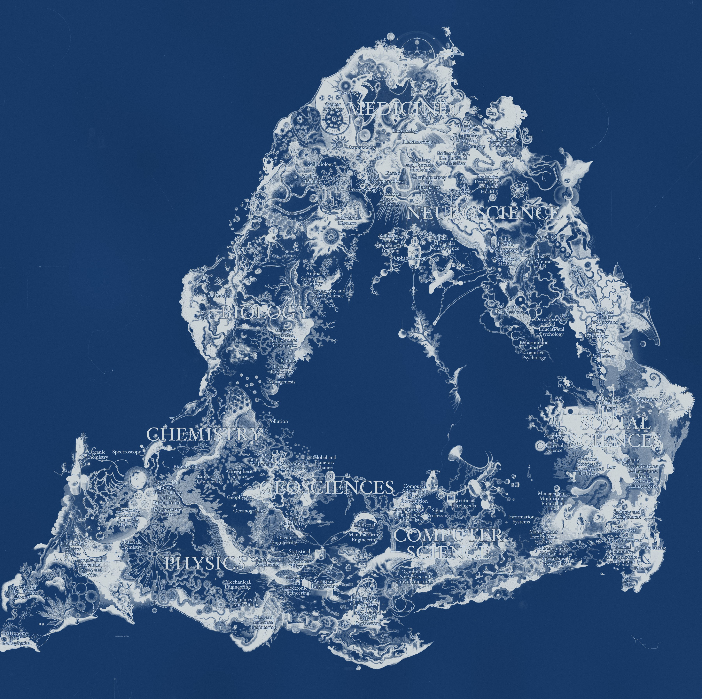
  <div class="t-kicker">HAI101 · LSE · 6 November 2026</div>
  <h1 class="t-title">Uncovering the<br>general structure<br>of model transfer<br>between sciences</h1>
  <div class="t-by">Max Noichl</div>
</div>
```


# Introduction

* Doctoral candidate at Utrecht University in theoretical philosophy.
* Data-driven philosophy, philosophy with AI, complex collective cognition, philosophy of science.
* To follow along: [**maxnoichl.eu/talk**](https://maxnoichl.eu/talk)
* Today: *Uncovering the general structure of model transfer between sciences*


# {.cyan-part background-color="#183a68"}

```{=html}
<div class="cyan-stage title-stage plan-stage">
  <div class="ground"></div>
  
  <div class="t-kicker" style="top:282px">The plan</div>
  <ol class="plan-list">
    <li class="fragment"><span class="num">I</span><span class="txt">Model transfer</span></li>
    <li class="fragment"><span class="num">II</span><span class="txt">Interlude: OA Atlas</span></li>
    <li class="fragment"><span class="num">III</span><span class="txt">Applications</span></li>
    <li class="fragment"><span class="num">IV</span><span class="txt">Generalizing the approach</span></li>
    <li class="fragment"><span class="num">V</span><span class="txt">The structure of model transfer</span></li>
  </ol>
</div>
```


# {.cyan-part background-color="#183a68"}

```{=html}
<div class="cyan-stage">
  <div class="ground"></div>
  
  <div class="kicker">Part I</div>
  <div class="part-title">Model transfer</div>
</div>
```

<!-- Part I content -->

# Model transfer

* A model gets developed for one domain, and becomes applicable to very different others.
* Some examples: *Lotka–Volterra Model*, *Kuramoto Model*, *Hopfield Model*, *NK-Model*
* Real transfer, convergence, adaptation?
* Philosophically interesting:
  * (Computational) Reorganization of Science?
  * Scientific Creativity (and: predicting science)
  * Pragmatism or metaphysics?

::: aside
@humphreysExtendingOurselvesComputational2004 @knuuttilaModelTemplatesTransdisciplinary2023 @houkesTransferTemplatesScientific2019 @herfeldKnowledgeTransferIts2019
:::

# {.cyan-part background-color="#183a68"}

```{=html}
<div class="cyan-stage">
  <div class="ground"></div>
  
  <div class="kicker">Part II · Interlude</div>
  <div class="part-title">OA Atlas</div>
</div>
```


# {background-iframe="https://huggingface.co/spaces/MaxNoichl/oa-atlas/embed" background-interactive="true"}

::: {.absolute top=-520 left=560 width="800" height="300" style="font-size: 0.75em; overflow-wrap: anywhere; text-align: right;"}
<a href="https://huggingface.co/spaces/MaxNoichl/oa-atlas">https://huggingface.co/spaces/MaxNoichl/oa-atlas</a> 
:::

## {background-iframe="https://maxnoichl-openalex-mapper.hf.space" background-interactive="true"}

::: {.absolute top=-520 left=560 width="800" height="300" style="font-size: 0.75em; overflow-wrap: anywhere; text-align: right;"}
<a href="https://maxnoichl-openalex-mapper.hf.space">https://maxnoichl-openalex-mapper.hf.space</a> 
:::

## {background-iframe="https://possible-life-project-openalex-mapper-strong-gpu.hf.space" background-interactive="true"}

::: {.absolute top=10 left=560 width="800" height="300" style="font-size: 0.75em; overflow-wrap: anywhere; text-align: right;"}
<a href="https://possible-life-project-openalex-mapper-strong-gpu.hf.space">https://possible-life-project-openalex-mapper-strong-gpu.hf.space</a> 
:::


#

::: {.image-container}
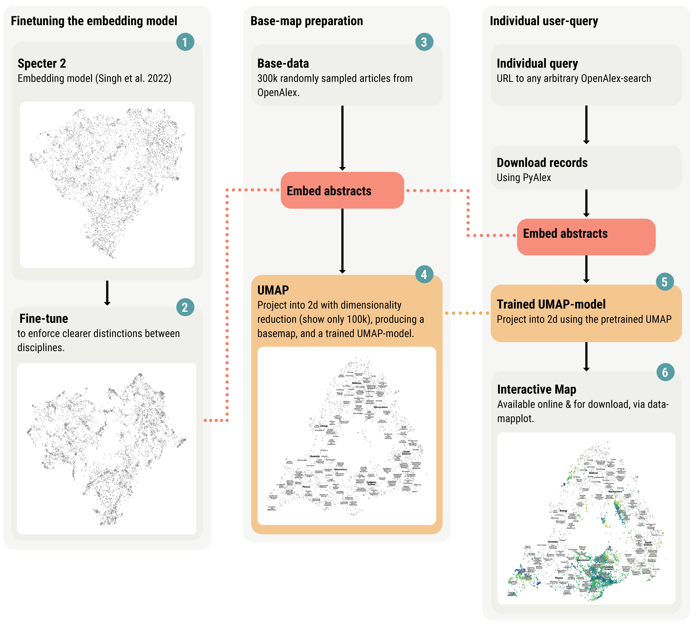{.remove_background width="60%"}
:::
[OA Atlas]{.leadin} The workflow. <br>
@priemOpenAlexFullyopenIndex2022 @singhSciRepEvalMultiFormatBenchmark2023 @mcinnesUMAPUniformManifold2018 @debruinPyAlex2023


# Now, why is this useful for PhilSci?

* Philosophers need to be acquainted with science:
  * Training, interviews, case studies, etc.
* Problem: generalization, validation?
  * Interactive, large-scale computational analysis.
<!-- Pence on comp. philosophy practice here -->


# {.cyan-part background-color="#183a68"}

```{=html}
<div class="cyan-stage">
  <div class="ground"></div>
  
  <div class="kicker">Part III</div>
  <div class="part-title">Applications</div>
</div>
```


# 

::: {.image-container}
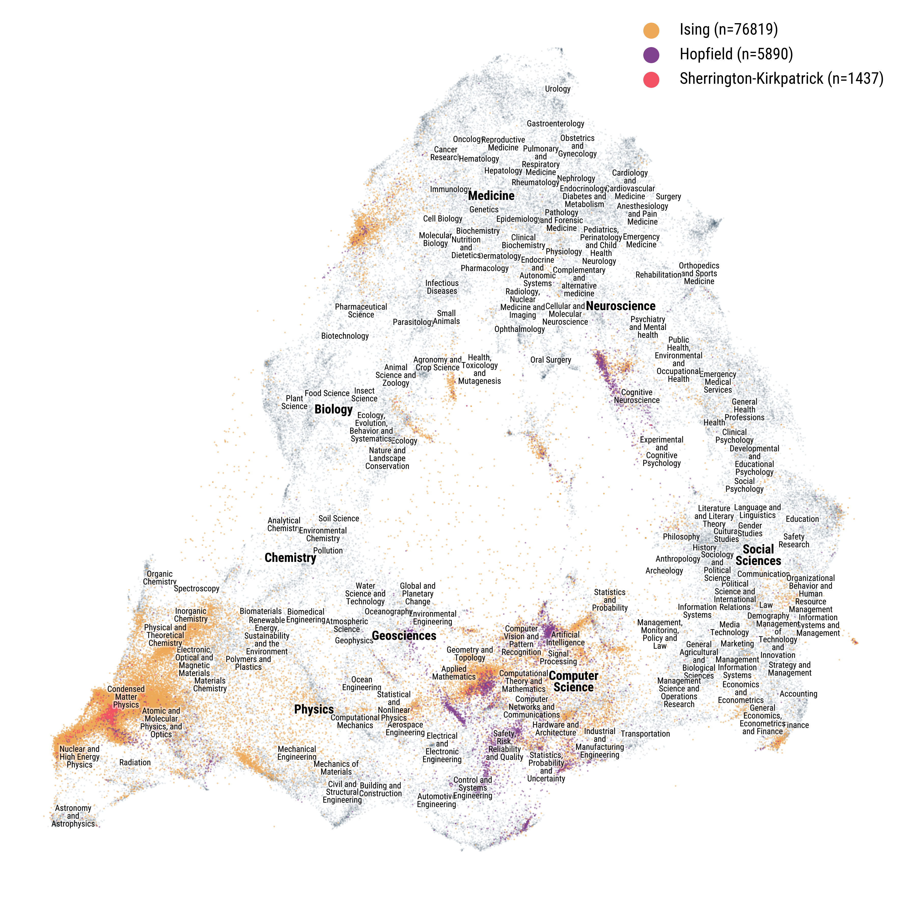{.remove_background width="60%"}
:::

[Model templates]{.leadin} Debates about model transfer in science, model templates as a structuring principle orthogonal to disciplines. <br>
@humphreysExtendingOurselvesComputational2004 @knuuttilaModelTemplatesTransdisciplinary2023


<!-- # 

::: {.image-container}
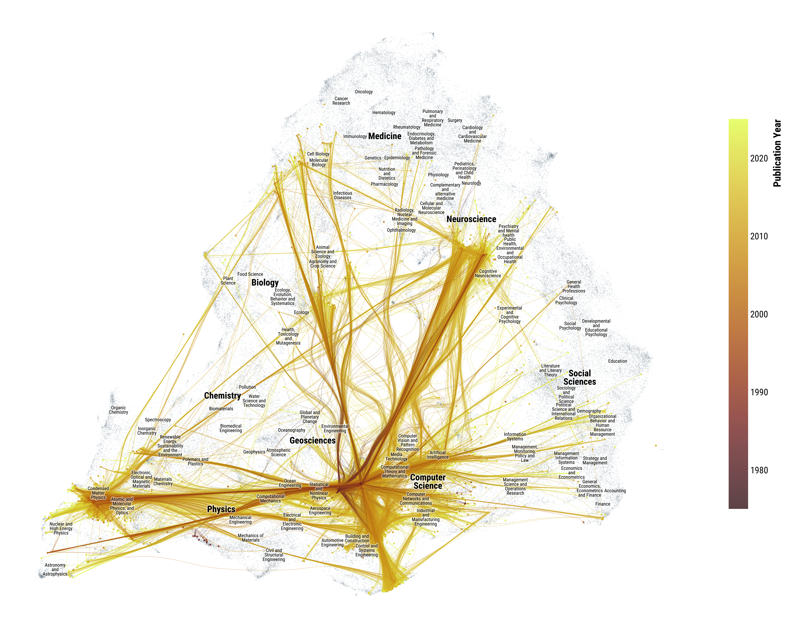{.remove_background width="75%"}
:::

[Model templates —]{.leadin} Distribution of the Kuramoto model across disciplines. <br>
@knuuttilaModelTemplatesTransdisciplinary2023
[Knuttila, Loettgers & Noichl under review]{style="font-family: 'Roboto Condensed'"} -->


#
::: {.image-container}
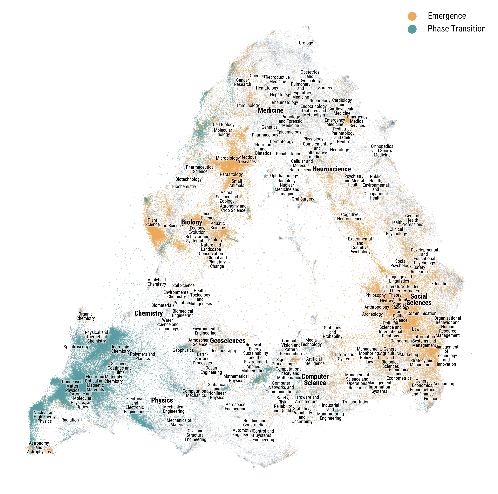{.remove_background width="60%"}
:::
[Concepts]{.leadin} Distribution of concepts over large, interdisciplinary samples. <br>
@malaterreRecipesPhilosophyScience2020 @zichertTracingDevelopmentVirtual2024


## {background-iframe="images/evolution_umap_with_claude_labels_darwinian_terms.html" background-interactive="true"}


# 
::: {.image-container}
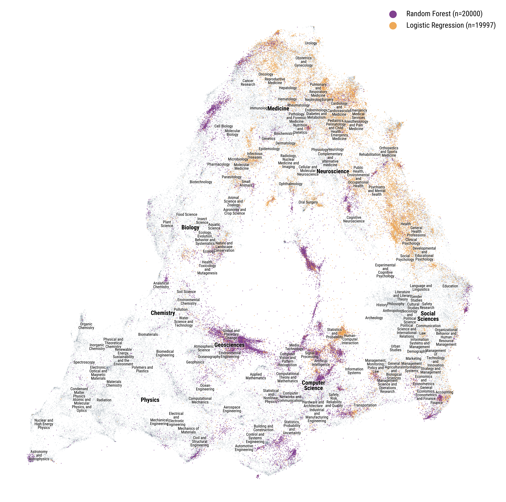{.remove_background width="60%"}
:::

[Methods]{.leadin} Relevant for debates on machine learning in science vs. class. statistics, theory-free science. <br>@breimanStatisticalModelingTwo2001 @bzdokStatisticsMachineLearning2018 @andrewsDevilDataMachine

# 
::: {.image-container}
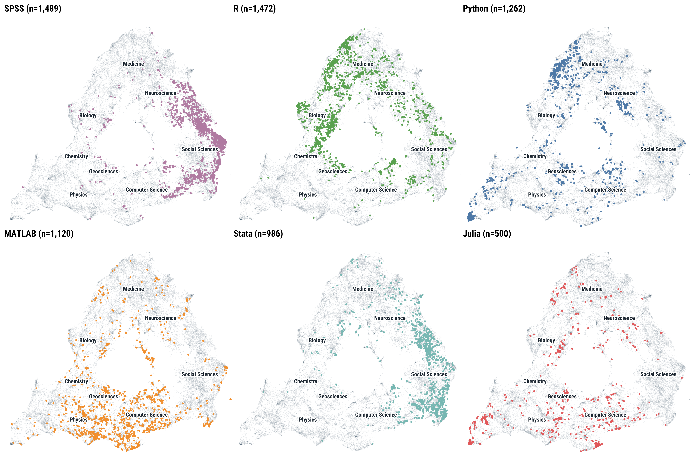{.remove_background width="85%"}
:::

[Computational substrates]{.leadin} Distribution of programming and statistical languages across scientific fields. <br>

# 
::: {.image-container}
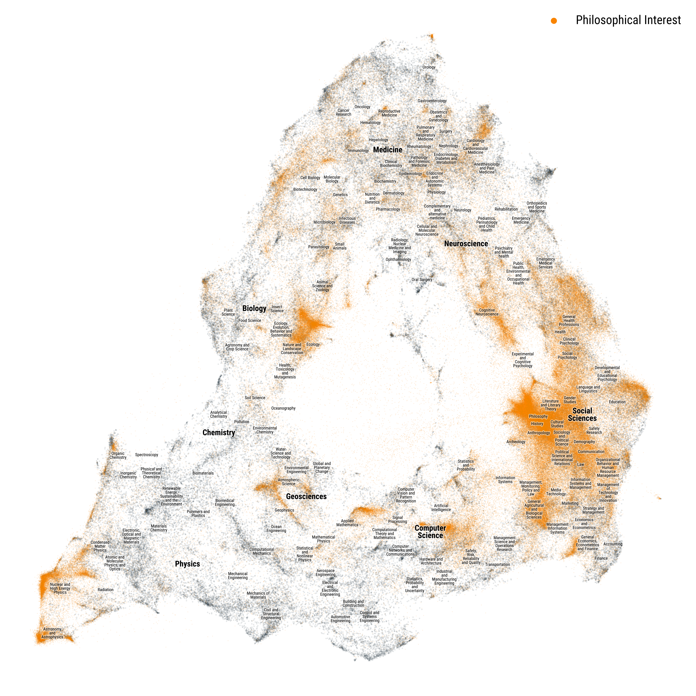{.remove_background width="60%"}
:::

[Attention of HPS]{.leadin} 500k sources of the history and philosophy of science literature. <br>
@weingartFindingHistoryPhilosophy2015

##
<div style="font-size: 0.8em;">
| Journal | Number of Papers |
|:-------|----------------:|
| Isis | 22858 |
| Technology and Culture | 13140 |
| Journal of Philosophy | 12806 |
| Synthese | 10484 |
| Philosophy of Science | 7432 |
| British Journal for the History of Science | 5810 |
| British Journal for the Philosophy of Science | 4380 |
| Journal for the History of Astronomy | 3194 |
| Studies in History and Philosophy of Science | 2798 |
| Annals of Science | 2742 |
| Social Studies of Science | 2176 |
| History of Science | 1511 |
| Studies in History and Philosophy of Modern Physics | 1227 |
| Archive for History of Exact Sciences | 1088 |
| Osiris | 960 |
| History and Philosophy of the Life Sciences | 914 |
| Historical Studies in the Natural Sciences | 602 |
</div>


# {.cyan-part background-color="#183a68"}

```{=html}
<div class="cyan-stage">
  <div class="ground"></div>
  
  <div class="kicker" style="top:372px">Part IV</div>
  <div class="part-title" style="top:404px">Generalizing<br>the approach</div>
</div>
```

<!-- Part IV content -->


# Identifying Models

* Search on OpenAlex (OA) for `model`, `equation`, `process`, `map`, `automaton`.
* Retrieve 1M random records.
* Use gpt-6.1 Sol to filter raw strings: "SIR model" vs. "mouse model"
* Arrange by shortest path on substring similarity, merge in batches & filter.
* 3,380 candidate models. Search canonical names on OA.
* Keep 1,338 models with more than 1,000 mentions.

<!-- Data summary
1. Catalogue: which models

Model names were extracted from OpenAlex titles and abstracts, then cleaned and grouped by Codex in batches. Recurring problems were names mistaken for verbs, truncated phrases and capitalised ordinary words; these are logged in procedure_notes.md.
Result: 3,380 candidate model groups, each with a first-pass OpenAlex population (count of matching papers).
1,338 models with a population of at least 1,000 papers were kept.
2. Query research: how we searched

For each model, one Codex run (GPT-6.1, medium reasoning effort, live web search) wrote a retrieval plan for OpenAlex. Each plan was then validated against OpenAlex.
1,741 Codex runs for 1,338 models:
1,089 models needed one run;
122 needed two, 100 needed three, 27 needed four;
381 runs failed, mostly offline or connection failures overnight and on the train, and were rerun.
A plan combines text routes (exact phrases in title/abstract, sometimes full text) with citation routes (papers citing canonical sources, such as the Berkson papers for logistic regression).
In total: 10,543 text routes and 1,334 citation routes. A median of 9 routes per model (5–11).
Each plan logs what was included and what was deliberately left out. For example, for logistic regression the bare "logit" and "LR" were left out as too ambiguous.
3. Retrieval population: how big each model's literature is (union of all routes)

Top: artificial neural network 3.33M, linear regression 2.65M, logistic regression 2.18M, deep neural network 2.00M, linear model 1.84M.
Bottom: dot system 271, Godunov–Peshkov–Romenski 358, Maxwell–Boltzmann equation 626, Watson–Crick automaton 955, Yang–Baxter map 1,205.
Median: 24,358 papers. 203 models have more than 100k.
Five models fall below the 1,000 cutoff here because the final, researched queries are narrower than the first-pass count.
4. Download: the sample

Up to 5,000 papers per model, a seeded random sample of each model's union. 60 models have fewer, because their whole population is smaller.
5,630,427 unique papers, 6,587,911 model memberships. About 15% of memberships point to a paper shared with another model.
Each paper has title, abstract, year, date, field, citation count and reference list.
1,251,943 papers have a title only, no abstract. 1,992 have no text at all and are excluded from embedding.
OpenAlex cost: the balance went from $53.77 to $15.23 between 02:20 and 07:44 (about $38.5). The earlier partial download isn't in that log.
5. Embedding and projection

Embedding: Qwen3-Embedding-0.6B, title + abstract, up to 2,048 tokens, 1,024 dimensions, stored as float16.
5,628,435 papers in 2,749 shards. The endpoint run does about 26 shards/min,  -->


# Researching Models
* gpt-6.1 Sol with web access on high reasoning refines OA queries and checks them against common problems.
  * "SIR model" or "Susceptible–Infected–Recovered model" or "..."
* Download 5,000 random records per model, total 5.63M abstracts.
* Embed and project onto a basemap (qwen-embed-0.6)

::: aside
@zhangQwen3EmbeddingAdvancing2025
:::


<!-- Examples::: -->
# 
::: {.image-container}
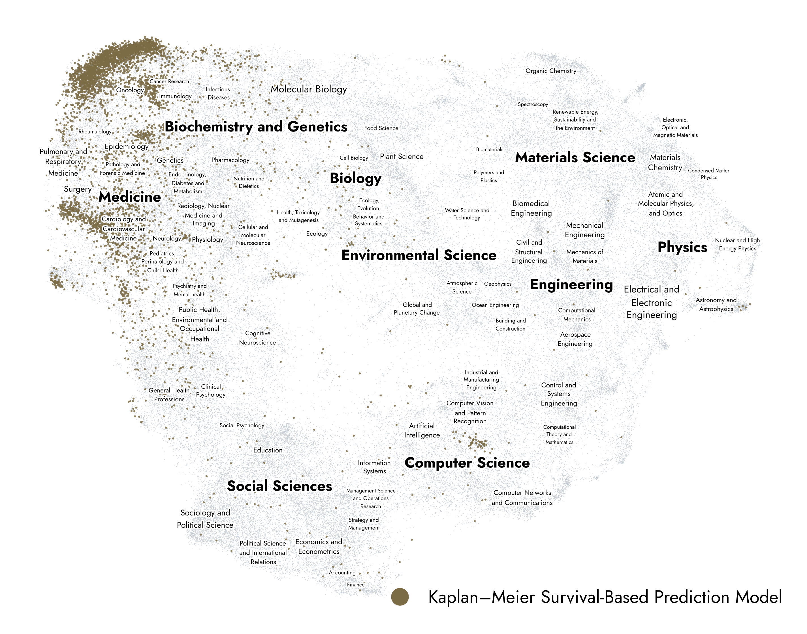{.remove_background width="75%"}
:::

[Kaplan–Meier survival model]{.leadin} Model of survival processes. Concentrated in medicine & genomics.

# 
::: {.image-container}
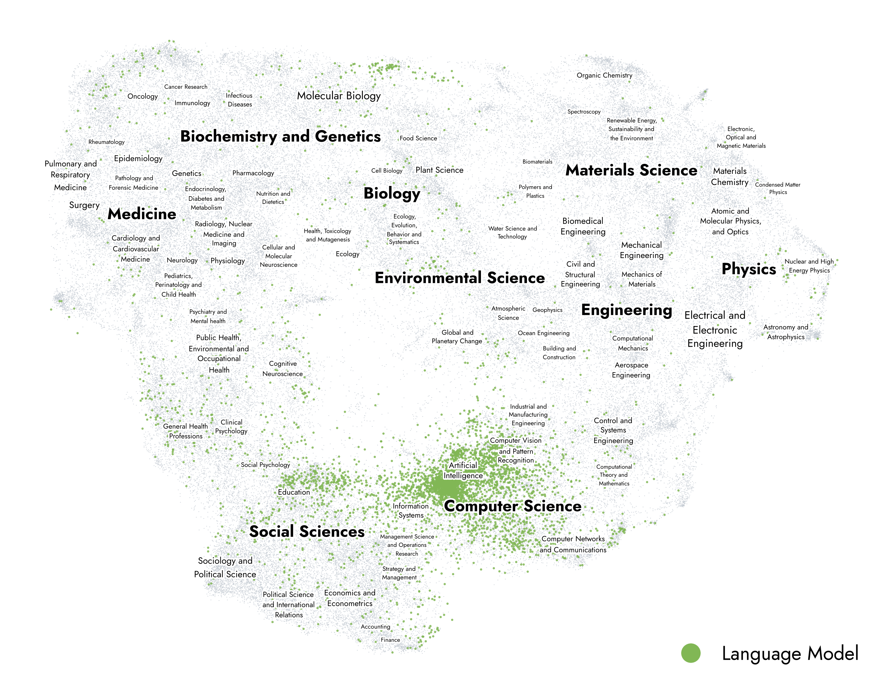{.remove_background width="75%"}
:::

[Language model]{.leadin} Centred on computer science and AI, reaching into the social sciences and medicine.

# 
::: {.image-container}
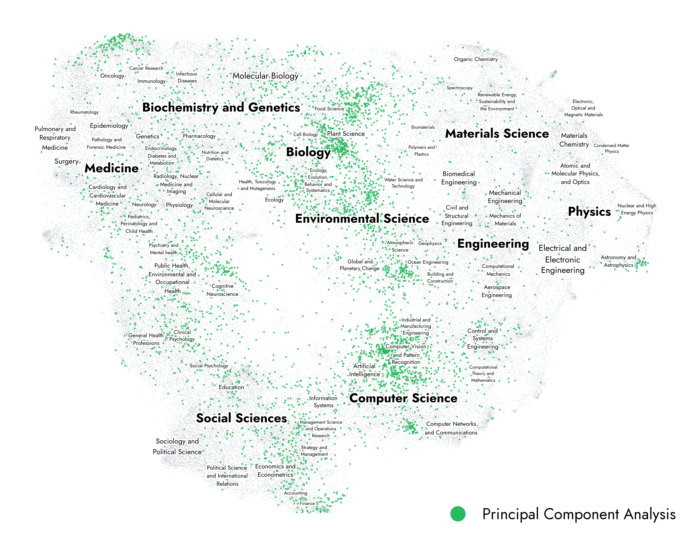{.remove_background width="75%"}
:::

[Principal component analysis]{.leadin} Basically everywhere.


# {.cyan-part background-color="#183a68"}

```{=html}
<div class="cyan-stage">
  <div class="ground"></div>
  
  <div class="kicker" style="top:372px">Part V</div>
  <div class="part-title" style="top:404px">The structure of<br>model transfer</div>
</div>
```

<!-- Part V content -->


<!-- Citations -->

# 
::: {.image-container}
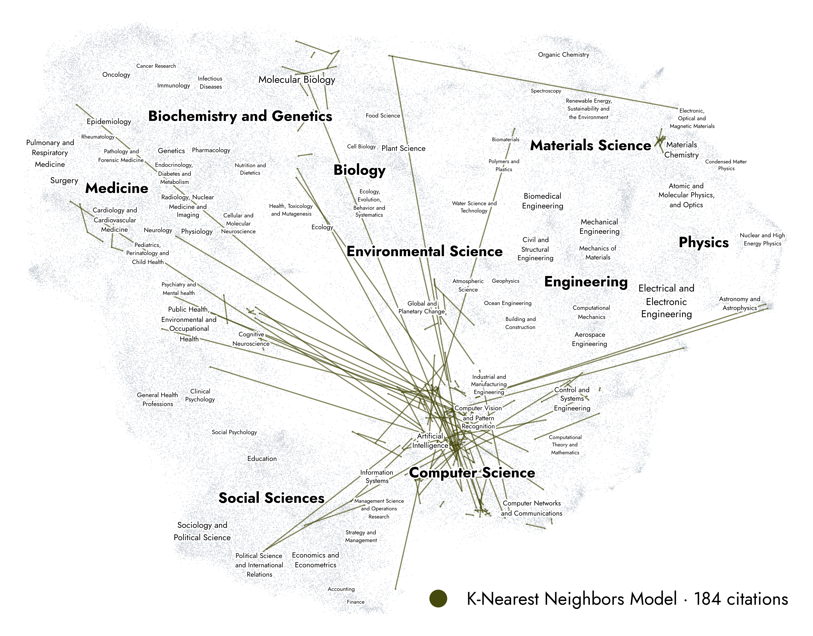{.remove_background width="75%"}
:::

[k-nearest neighbors]{.leadin} Citations between the papers that use kNN graphs.


<!-- Main path analysis SPLC Search path link count -->

# 
::: {.image-container}
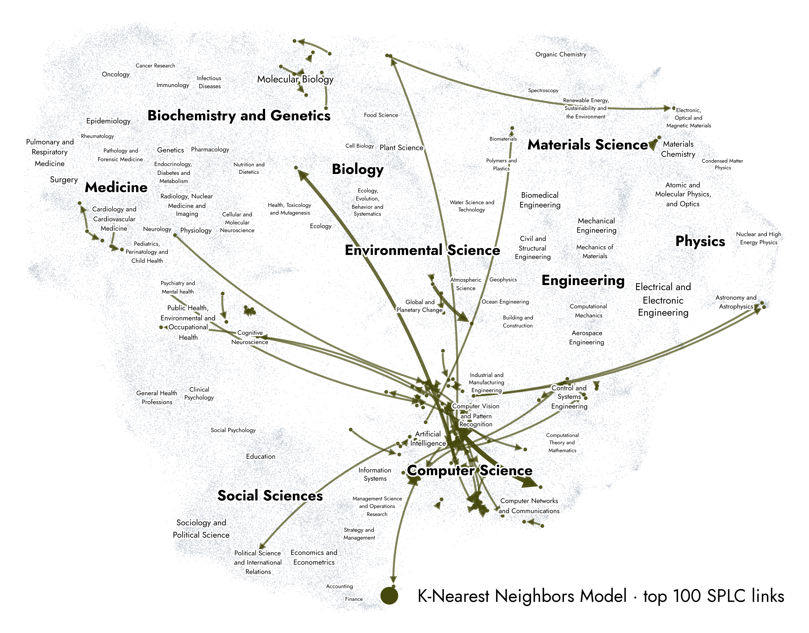{.remove_background width="75%"}
:::

[k-nearest neighbors]{.leadin} Main path analysis: the paths most travelled through the citation graph (SPLC). <br>
@hummonConnectivityCitationNetwork1989 @batageljEfficientAlgorithmsCitation2003


<!-- # aggregate by cluster.-->

# 
::: {.image-container}
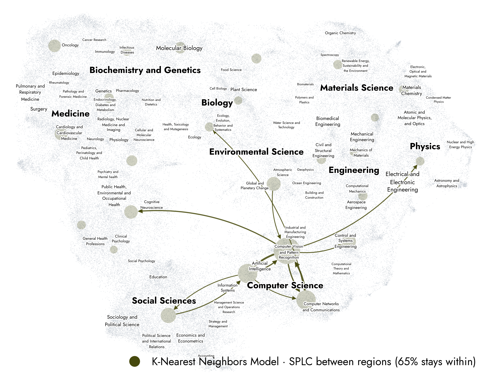{.remove_background width="75%"}
:::

[k-nearest neighbors]{.leadin} Aggregate SPLC by genieclust clusters between regions of the map.

<!-- umap of models -->

# {background-iframe="images/model_umap_site/model_umap.html" background-interactive="true"}

<!-- Start with endemic models in physics, then show some connection at the edges of Computer science.  -->

<!-- 
# First results

* Most flow is region-internal. Citations cover 30% of the models' extent.
* 
* External flow tends to be asymmetrical. -->


# 
::: {.image-container}
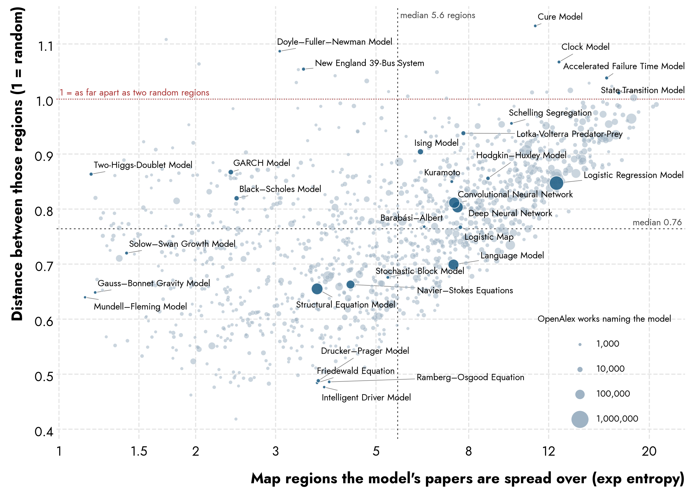{.remove_background width="80%"}
:::

[Spread]{.leadin} How many map regions does a model cover (x), and how far apart are they (y). Many models sit high on both. <br>

::: {.notes}
* x: effective number of regions (exp entropy), median 5.6. y: mean distance between those regions, 1 = as far apart as two random regions, median 0.76.
* Broad spread mostly comes with distance: the more regions, the farther apart they tend to be.
* Ising, Lotka–Volterra, Hodgkin–Huxley, Kuramoto and Schelling all sit above both medians.
* Top left: few regions, but far apart (Two-Higgs-Doublet, GARCH, Doyle–Fuller–Newman).
* Bottom: several regions close together (Friedewald, Ramberg–Osgood, Intelligent Driver Model).
* Top right: generic statistical machinery (logistic regression, cure and accelerated failure time models).
:::


# Some qualifications & further work
* OpenAlex is not perfect
* We're limited to sources that include abstracts (recency bias) and citations.
* Undersampling of citations.
* Expert review.
* Various UMAP issues.


<!--
# The proper role of comp. methods in PhilSci
* Involved quantitative methods ground qualitative investigation.
* Acquaintance, not necessarily hypothesis testing.
* Working paper: [Patterns, Pathways & Surprises: Introducing OA Atlas](main.pdf)
-->


# {.cyan-part background-color="#183a68"}

```{=html}
<div class="cyan-stage title-stage">
  <div class="ground"></div>
  
  <div class="t-kicker" style="top:376px">HAI101 · LSE · 6 November 2026</div>
  <h1 class="t-title thanks" style="top:404px">Thank you</h1>
  <div class="t-by" style="top:534px">maxnoichl.eu/talk</div>
</div>
```


<!-- # 

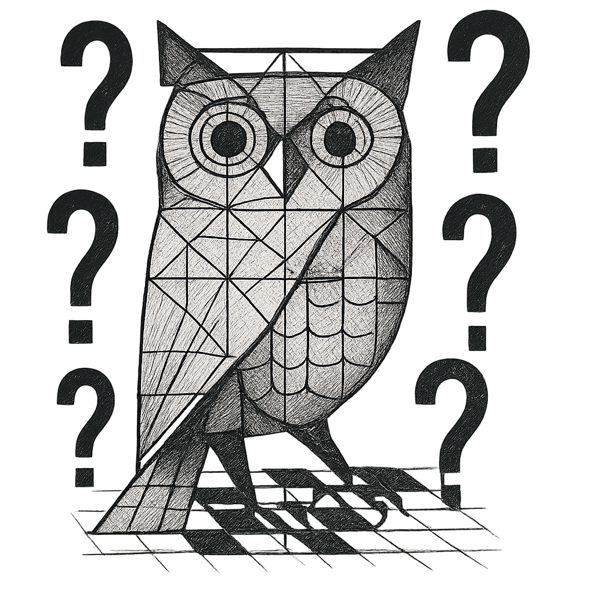{width=35% fig-align="center"}

<div style="text-align: center;">
<h1>Thank you!</h1>
</div> -->

# Literature
